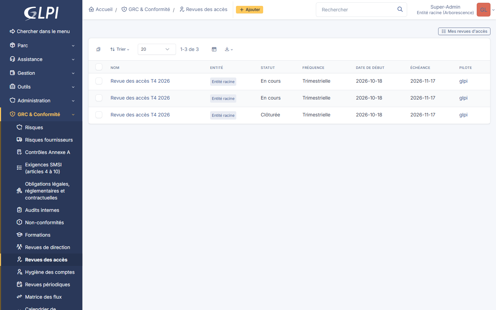
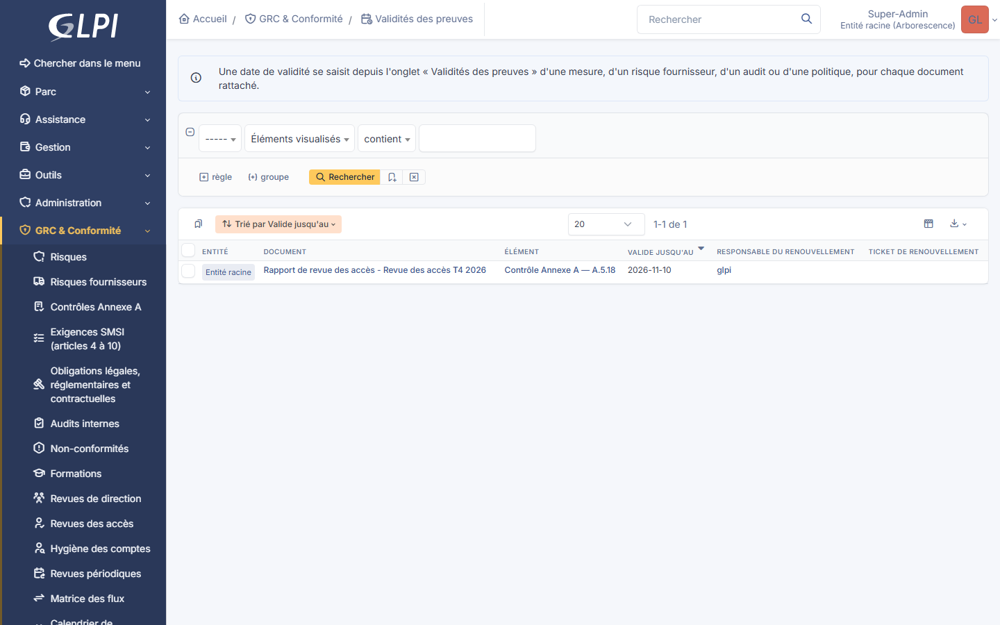
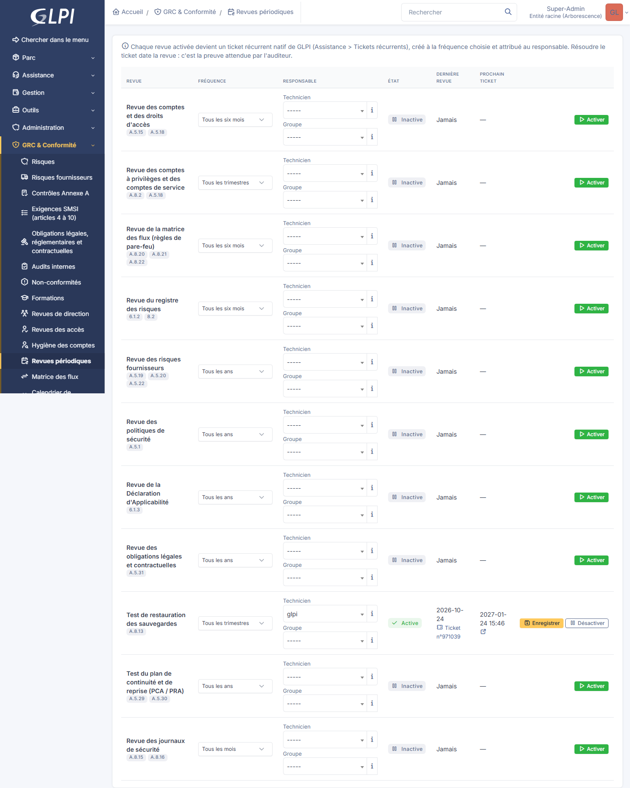
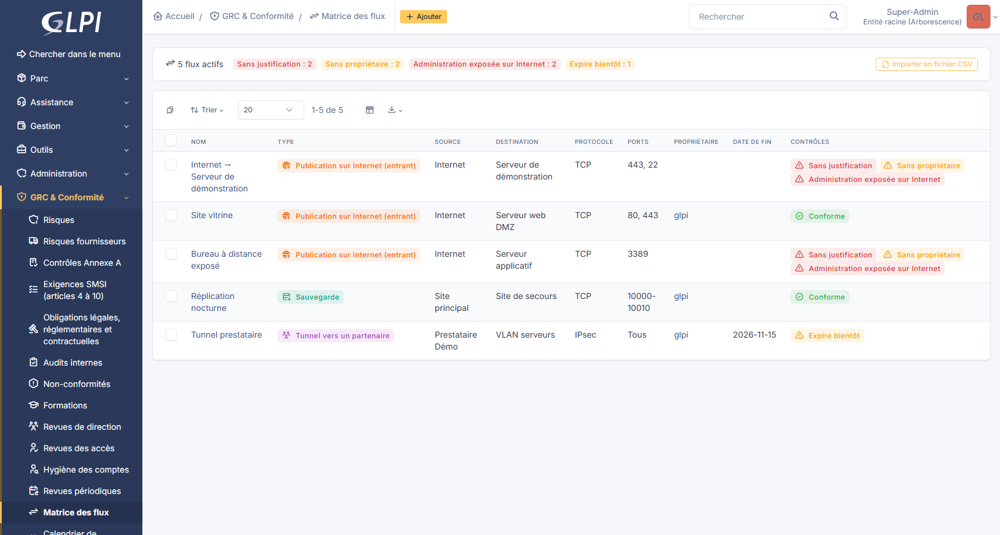
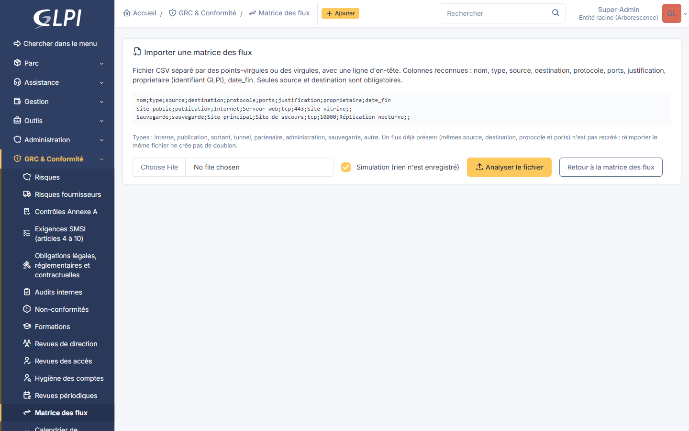
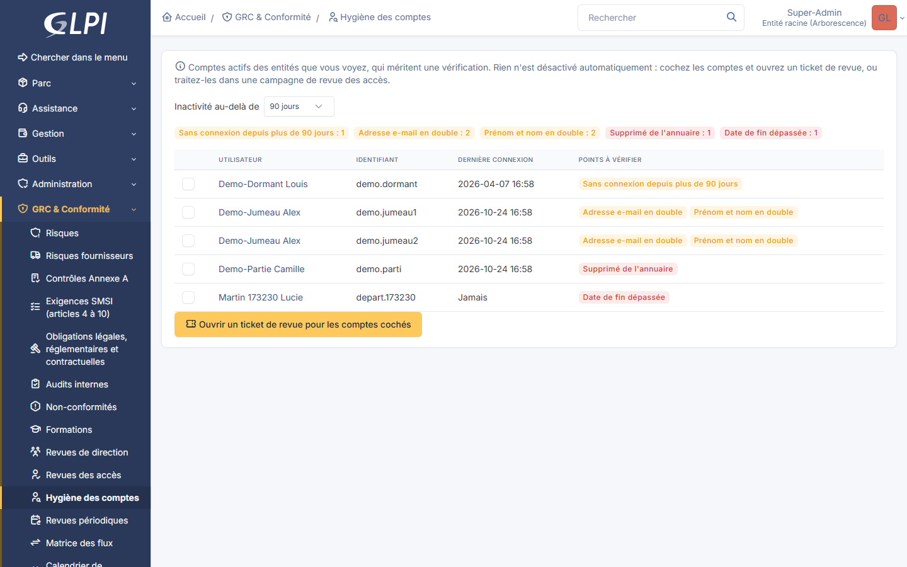
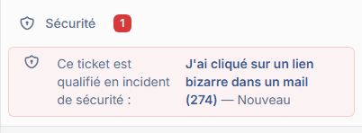
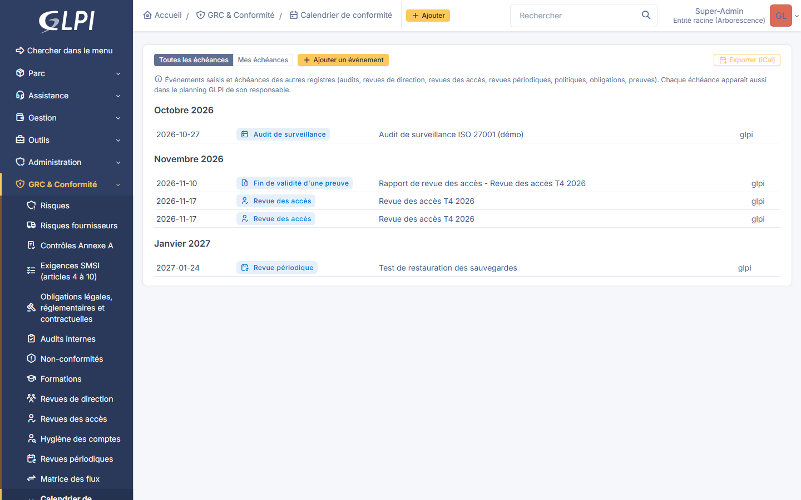
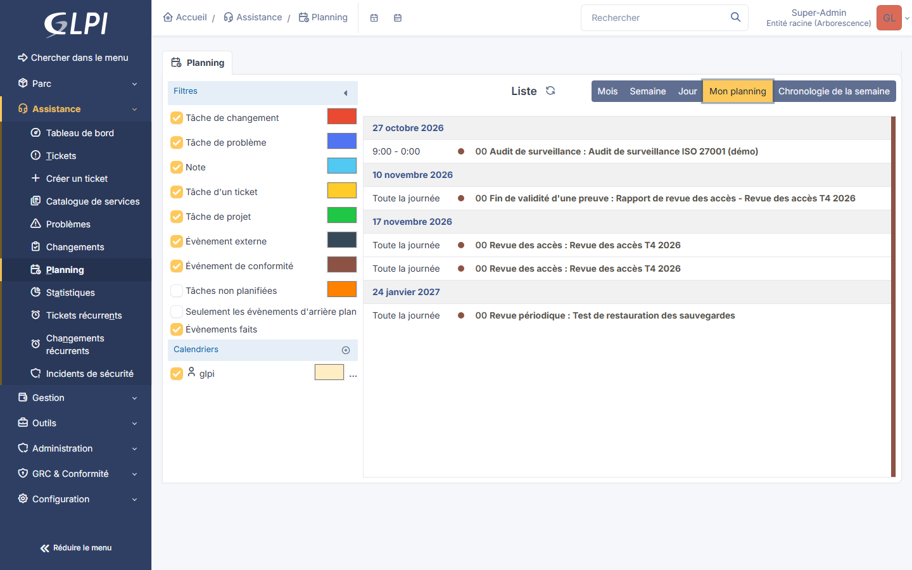

[🇫🇷 Français](#-français) · [🇬🇧 English](#-english)

## 🇫🇷 Français

**Tutoriel : Utilisation de GLPI GRC Manager**

Ce tutoriel parcourt le flux complet du plugin sur une instance GLPI 11 réelle : de l'activation
jusqu'au tableau de bord, en passant par le registre de risques génériques, la matrice
probabilité x impact, la Déclaration d'Applicabilité (SoA), le programme d'audit interne avec ses
actions correctives et préventives (CAPA), le registre de risques fournisseurs/tiers, le suivi des
formations, les revues de direction, le tableau de bord ISMS créé automatiquement à l'installation
et le suivi de version du plugin. Toutes les captures ci-dessous viennent d'une instance réelle,
avec de vraies données (exemples anonymisés).

### Étape 1 : Installer et activer le plugin

Le plugin s'installe comme n'importe quel plugin GLPI (voir le
[README.md](../README.md#installation) pour la procédure complète). Une fois le code en place,
depuis **Configuration > Plugins**, la ligne "GLPI GRC Manager" affiche son statut "Activé" une
fois l'installation et l'activation terminées.

Le plugin ajoute ses sept écrans (Risques, Risques fournisseurs, Contrôles Annexe A, Audits
internes, Non-conformités, Formations, Revues de direction) dans le menu **Outils**.

### Étape 2 : Créer un risque dans le registre générique

Depuis **Outils > Risques**, la liste est vide tant qu'aucun risque n'a été créé.

Un nouveau risque demande un titre, une catégorie (humain/processus/physique/tiers-fournisseur/
technique), une probabilité et un impact.

Une fois enregistré, le niveau de risque (faible/moyen/élevé/critique) et le score numérique sont
calculés automatiquement à partir de la probabilité et de l'impact, selon la matrice configurée
(voir étape 3).

Le propriétaire du risque peut ensuite fixer une décision de traitement (accepter/mitiger/
transférer/éviter) accompagnée d'une justification.

La liste affiche ensuite chaque risque avec des badges colorés pour la catégorie, le niveau de
risque, l'impact et le traitement.

### Étape 3 : Configurer la matrice probabilité x impact

Depuis **Configuration > Plugins**, l'icône en forme de clé sur la ligne du plugin ouvre l'écran
de configuration de la matrice de risque : chaque combinaison probabilité/impact peut être
associée au niveau de risque de son choix (faible/moyen/élevé/critique), avec un aperçu coloré
mis à jour en direct. Les valeurs par défaut reproduisent le comportement du registre avant que
cet écran n'existe : aucun risque existant ne change de niveau tant que la grille n'est pas
modifiée.

### Étape 4 : Parcourir la Déclaration d'Applicabilité (SoA)

Depuis **Outils > Contrôles Annexe A**, les 93 mesures réelles de l'Annexe A ISO/IEC 27001:2022
sont listées, préchargées à l'installation et marquées "Applicable" par défaut (clause 6.1.3).

La liste peut être filtrée par thème (Organisationnel, Humain, Physique, Technologique) grâce au
formulaire de recherche natif de GLPI.

Chaque contrôle s'ouvre pour ajuster son applicabilité (applicable/non applicable/partiellement
applicable) et son état de mise en œuvre.

Dès que l'applicabilité passe à "Non applicable" ou "Partiellement applicable", une justification
devient obligatoire (clause 6.1.3 d) : tenter d'enregistrer sans la renseigner affiche une erreur
et bloque l'enregistrement.

Une fois la justification renseignée, l'enregistrement réussit.

### Étape 5 : Créer un audit et une non-conformité, jusqu'à la clôture CAPA

Depuis **GRC & Conformité > Audits et amélioration**, la liste est vide tant qu'aucun audit n'existe.

Un audit se définit par un titre, un statut, une date planifiée et un périmètre libre.

Les documents de l'audit (plan d'audit, preuves collectées, rapport signé) et de ses constats ne se
lisent que par son **équipe** : l'auditeur et le responsable de la fiche, les membres ajoutés dans
l'onglet **Équipe** (auditeurs, ou audités en lecture seule) et le **groupe RSSI** choisi dans la
configuration du plugin. Le droit Documents de GLPI ne suffit pas. L'onglet **Accès aux documents**
liste chaque téléchargement (date, utilisateur, document) et l'onglet **Notes** garde les notes de
travail datées, avec leur auteur.

Depuis l'onglet **Non-conformités** de la rubrique, une non-conformité peut être liée à cet audit interne, avec
une sévérité, une échéance, une description et une cause racine.

Le cycle CAPA (clause 10.2 ISO/IEC 27001:2022) impose une action corrective avant de pouvoir
clôturer ou vérifier une non-conformité : tenter de passer au statut "Vérifiée" sans action
corrective renseignée bloque l'enregistrement.

Une fois l'action corrective (et, le cas échéant, l'action préventive) renseignée, la
non-conformité peut être vérifiée : la date de vérification de clôture est alors automatiquement
renseignée à la date du jour si elle est restée vide.

### Étape 6 : Ajouter les indicateurs à un tableau de bord

Le plugin ajoute ses propres cartes à l'éditeur de tableau de bord natif de GLPI : aucun écran à
part. Depuis un tableau de bord, mode édition, cliquer sur une case vide ouvre "Ajouter une
carte" : les cartes du plugin apparaissent groupées sous "GRC Manager" (risques ouverts par
niveau et par catégorie, contrôles SoA revus et par applicabilité, non-conformités ouvertes,
actions correctives/préventives en retard, audits par statut...).

Une fois ajoutée, la carte affiche la donnée réelle, ici le nombre de risques ouverts du
registre.

### Étape 7 : Créer un risque dans le registre fournisseurs/tiers

Depuis **Outils > Risques fournisseurs**, la liste affiche les risques fournisseurs déjà
enregistrés sur cette instance.

Un nouveau risque fournisseur reprend exactement les mêmes champs catégorie/probabilité/impact
que le registre générique (voir étape 2), avec en plus un fournisseur GLPI natif (itemtype
`Supplier` du cœur GLPI) obligatoire : ce registre couvre la dépendance à un tiers (clause
6.1.2/8.2, Annexe A.5.19-A.5.22).

Comme pour le registre générique, le niveau de risque et le score sont calculés automatiquement
à l'enregistrement, selon la même matrice probabilité x impact configurée à l'étape 3.

Le même cycle de décision de traitement (accepter/mitiger/transférer/éviter) et de justification
que le registre générique s'applique ensuite.

La liste affiche ensuite chaque risque fournisseur avec le fournisseur GLPI lié et les mêmes
badges colorés que le registre générique.

### Étape 8 : Suivre une formation et la réalisation par participant

Depuis **Outils > Formations**, la liste affiche les sessions déjà enregistrées.

Une formation se définit par un titre, un format (présentiel/e-learning/autre), une date de
réalisation, un public cible, un caractère obligatoire ou non et, le cas échéant, une périodicité
de renouvellement en mois (clauses 7.2 « compétence » et 7.3 « sensibilisation »). Les
participants, de vrais utilisateurs GLPI, sont sélectionnés dans le même formulaire.

Une fois enregistrée, un tableau de suivi individuel apparaît sous le formulaire : un statut de
réalisation (en attente/terminée/dispensé) et une date par participant.

Faire passer un participant au statut « Terminée » avec sa date de réalisation, puis enregistrer :
son suivi individuel est à jour, et la formation compte désormais dans le taux de réalisation
affiché au tableau de bord (voir étape 10).

### Étape 9 : Enregistrer une revue de direction

Depuis **Outils > Revues de direction**, la liste affiche les revues déjà enregistrées.

Une revue de direction (clause 9.3) se définit par un titre, un statut (planifiée/terminée), des
participants, un ordre du jour et les décisions/actions qui en ressortent. Si le statut est
positionné à « Terminée » sans indiquer de date de revue, celle-ci est automatiquement renseignée
à la date du jour lors de l'enregistrement.

### Étape 10 : Consulter le tableau de bord ISMS par défaut

Depuis la v1.0.0, l'installation du plugin crée automatiquement un tableau de bord natif GLPI
« GRC Manager - Vue d'ensemble ISMS », visible par tout utilisateur disposant du droit natif
« Tableaux de bord » (sélecteur en haut de n'importe quel tableau de bord GLPI) : une installation
fraîche affiche d'emblée une vue d'ensemble ISMS au lieu d'un écran vide à composer soi-même. Il
reprend les mêmes cartes KPI du plugin déjà présentées à l'étape 6, organisées en une rangée de
chiffres clés, une rangée d'indicateurs de progression, puis des répartitions par registre.

### Étape 11 : Suivre la version du plugin

Depuis **Configuration > Plugins**, l'icône en forme de clé ouvre le même écran de configuration
qu'à l'étape 3 (matrice de risque) : une carte en haut de l'écran compare désormais la version
installée à la dernière version publiée sur GitHub (mise en cache 24 h), avec un badge orange en
cas d'écart et vert lorsque l'instance est à jour.

---

> Les étapes 12 à 18 ont été capturées sur GLPI 12 avec la version 2.6.0 (données fictives). Depuis
> la 2.0, les écrans du plugin sont regroupés dans le menu **GRC & Conformité**.

### Étape 12 : Lancer une campagne de revue des accès

Depuis **GRC & Conformité > Opérations > Revues des accès**, une campagne liste les comptes à revoir et les
confie à leurs responsables (supérieur hiérarchique, responsable de groupe ou pilote). Chaque
responsable traite ses lignes depuis **Mes revues d'accès** : conserver, modifier ou retirer. Un
droit à retirer devient un ticket ; le plugin ne retire jamais un droit lui-même. À la clôture, un
rapport PDF est joint à la campagne et à la mesure de l'Annexe A concernée.

### Étape 13 : Dater la validité des preuves

Sur une mesure, un risque fournisseur, un audit ou une politique, l'onglet **Validités des
preuves** donne une date de fin de validité à chaque document rattaché (certificat, rapport,
attestation). Le responsable est prévenu 30 jours avant ; à l'expiration, un ticket « Renouveler la
preuve » est ouvert. **GRC & Conformité > Conformité > Preuves** les rassemble toutes.

### Étape 14 : Planifier les revues périodiques

**GRC & Conformité > Opérations > Revues périodiques** propose onze revues (droits d'accès, comptes à
privilèges, matrice des flux, registre des risques, fournisseurs, politiques, SoA, obligations,
tests de restauration et de PCA, journaux de sécurité). **Activer** une revue crée un ticket
récurrent GLPI attribué au responsable choisi, avec sa check-list. Quand le ticket est résolu, la
date de la dernière revue s'affiche : c'est la preuve attendue par l'auditeur. Une revue non faite
sur sa période passe « En retard ».

### Étape 15 : Tenir la matrice des flux réseau

**GRC & Conformité > Sécurité technique > Matrice des flux** recense les flux autorisés : source et destination (un
actif GLPI ou un réseau, une zone, une adresse), protocole, ports, justification, propriétaire et
date de fin. Les contrôles automatiques signalent les flux sans justification ou sans propriétaire,
expirés, et les services d'administration publiés sur Internet.

Une matrice existante s'importe en CSV, avec une simulation qui n'écrit rien ; réimporter le même
fichier ne crée pas de doublon.

### Étape 16 : Vérifier l'hygiène des comptes

**GRC & Conformité > Opérations > Hygiène des comptes** liste les comptes actifs à vérifier : supprimés de
l'annuaire, date de fin dépassée, sans connexion depuis N jours ou jamais utilisés, en double.
Cochez les comptes et ouvrez un ticket de revue ; aucun compte n'est désactivé automatiquement.

### Étape 17 : Escalader un ticket en incident de sécurité

Sur un ticket classique (« j'ai cliqué sur un lien bizarre »), la section **Sécurité** du panneau
de droite propose **Escalader en incident de sécurité** : l'incident reprend le titre, la
description, le demandeur et les éléments liés, et le ticket garde son statut. Une fois qualifié,
la section affiche le lien vers l'incident. L'action existe aussi en action groupée sur la liste
des tickets.

### Étape 18 : Suivre le calendrier de conformité

**GRC & Conformité > Tableau de bord > Calendrier de conformité** réunit les événements saisis (audit de
certification ou de surveillance, test d'intrusion, exercice de crise…) et les échéances des autres
registres : audits, revues de direction, revues des accès, revues périodiques, politiques,
obligations, preuves. Il s'exporte en iCal.

Chaque échéance apparaît aussi dans le **planning GLPI** de son responsable, en lecture seule.

## 🇬🇧 English

**Tutorial: Using GLPI GRC Manager**

This tutorial walks through the plugin's full flow on a real GLPI 11 instance: from activation
to the dashboard, through the generic risk register, the probability x impact matrix, the
Statement of Applicability (SoA), the internal audit program with its corrective and preventive
actions (CAPA), the supplier/third-party risk register, training tracking, management reviews,
the ISMS dashboard created automatically at install time, and the plugin's version tracking.
Every screenshot below comes from a real instance, with real data (anonymized examples).

### Step 1: Install and activate the plugin

The plugin installs like any GLPI plugin (see [README.md](../README.md#installation) for the
full procedure). Once the code is in place, from **Configuration > Plugins**, the "GLPI GRC
Manager" row shows an "Activé" status once installation and activation are complete.

The plugin adds its seven screens (Risks, Supplier risks, Annex A Controls, Internal audits,
Non-conformities, Trainings, Management reviews) to the **Outils** menu.

### Step 2: Create a risk in the generic register

From **Outils > Risques**, the list is empty until a risk has been created.

A new risk requires a title, a category (people/process/physical/third party-supplier/
technical), a probability and an impact.

Once saved, the risk level (low/medium/high/critical) and the numeric score are computed
automatically from the probability and impact, according to the configured matrix (see step 3).

The risk owner can then set a treatment decision (accept/mitigate/transfer/avoid) together with
a justification.

The list then shows every risk with colored badges for category, risk level, impact and
treatment.

### Step 3: Configure the probability x impact matrix

From **Configuration > Plugins**, the wrench icon on the plugin's row opens the risk matrix
configuration screen: each probability/impact combination can be mapped to the risk level of
your choice (low/medium/high/critical), with a live-updating color preview. The default values
reproduce the register's behavior from before this screen existed: no existing risk changes
level until the grid is edited.

### Step 4: Browse the Statement of Applicability (SoA)

From **Outils > Contrôles Annexe A**, the 93 real ISO/IEC 27001:2022 Annex A controls are
listed, seeded at install time and marked "Applicable" by default (clause 6.1.3).

The list can be filtered by theme (Organizational, People, Physical, Technological) through
GLPI's native search form.

Each control opens to adjust its applicability (applicable/not applicable/partially applicable)
and its implementation status.

As soon as applicability changes to "Not applicable" or "Partially applicable", a justification
becomes mandatory (clause 6.1.3 d): trying to save without one shows an error and blocks the
save.

Once the justification is filled in, the save succeeds.

### Step 5: Create an audit and a non-conformity, through to CAPA closure

From **GRC & Conformité > Audits et amélioration**, the list is empty until an audit exists.

An audit is defined by a title, a status, a planned date and a free-text scope.

The documents of the audit (audit plan, collected evidence, signed report) and of its findings can
only be read by its **team**: the auditor and the owner set on the form, the members added in the
**Équipe** tab (auditors, or read-only auditees) and the **CISO group** chosen in the plugin
configuration. The GLPI Documents right is not enough. The **Accès aux documents** tab lists every
download (date, user, document) and the **Notes** tab keeps dated working notes with their author.

From the section's **Non-conformités** tab, a non-conformity can be linked to this internal audit, with a
severity, a due date, a description and a root cause.

The CAPA cycle (ISO/IEC 27001:2022 clause 10.2) requires a corrective action before a
non-conformity can be closed or verified: trying to switch to "Verified" status without a
corrective action blocks the save.

Once the corrective action (and, where relevant, the preventive action) is filled in, the
non-conformity can be verified: the closure verification date is then automatically stamped with
today's date if it was left blank.

### Step 6: Add the KPIs to a dashboard

The plugin adds its own cards to GLPI's native dashboard editor: no separate screen. From any
dashboard, edit mode, clicking an empty cell opens "Ajouter une carte": the plugin's cards appear
grouped under "GRC Manager" (open risks by level and category, SoA controls reviewed and by
applicability, open non-conformities, overdue corrective/preventive actions, audits by
status...).

Once added, the card shows the real data, here the number of open risks in the register.

### Step 7: Create a risk in the supplier/third-party register

From **Outils > Risques fournisseurs**, the list shows the supplier risks already recorded on
this instance.

A new supplier risk reuses exactly the same category/probability/impact fields as the generic
register (see step 2), plus a mandatory real GLPI supplier (the core `Supplier` itemtype): this
register covers dependency on a third party (clause 6.1.2/8.2, Annex A.5.19-A.5.22).

As with the generic register, the risk level and the numeric score are computed automatically on
save, using the same probability x impact matrix configured in step 3.

The same treatment decision cycle (accept/mitigate/transfer/avoid) and justification as the
generic register apply next.

The list then shows every supplier risk with its linked GLPI supplier and the same colored
badges as the generic register.

### Step 8: Record a training session and a participant's completion

From **Outils > Formations**, the list shows the sessions already recorded.

A training is defined by a title, a format (in-person/e-learning/other), a delivery date, a
target audience, whether it's mandatory, and, where relevant, a renewal period in months
(clauses 7.2 "competence" and 7.3 "awareness"). Participants, real GLPI users, are selected on
the same form.

Once saved, a per-participant tracking table appears below the form: a completion status
(pending/completed/exempted) and a date for each participant.

Switching a participant's status to "Terminée" (completed) with their completion date, then
saving: that participant's individual tracking is up to date, and the training now counts towards
the completion rate shown on the dashboard (see step 10).

### Step 9: Record a management review

From **Outils > Revues de direction**, the list shows the reviews already recorded.

A management review (clause 9.3) is defined by a title, a status (planned/completed),
participants, an agenda and the decisions/actions that came out of it. If the status is set to
"Terminée" (completed) without a review date, it is automatically stamped with today's date on
save.

### Step 10: Browse the default ISMS dashboard

Since v1.0.0, installing the plugin automatically creates a native GLPI dashboard, "GRC Manager -
Vue d'ensemble ISMS", visible to any user with the native "Dashboards" right (the selector at the
top of any GLPI dashboard): a fresh install shows an ISMS overview right away instead of an empty
screen to build from scratch. It reuses the same plugin KPI cards already shown in step 6,
organized as a row of key figures, a row of progress indicators, then breakdowns per register.

### Step 11: Track the plugin's version

From **Configuration > Plugins**, the wrench icon opens the same configuration screen as step 3
(risk matrix): a card at the top of the screen now compares the installed version against the
latest version published on GitHub (cached for 24h), with an orange badge when they differ and a
green one once the instance is up to date.

> Steps 12 to 18 were captured on GLPI 12 with version 2.6.0 (sample data, French interface).
> Since 2.0, the plugin screens are grouped in the **GRC & Conformité** menu.

### Step 12: Run an access review campaign

From **GRC & Conformité > Opérations > Revues des accès** (access reviews), a campaign lists the accounts to
review and assigns them to their reviewers (manager, group owner or campaign owner). Each reviewer
handles their own lines from **Mes revues d'accès**: keep, change or remove. A right to remove
becomes a ticket; the plugin never removes a right itself. At closure, a PDF report is attached to
the campaign and to the related Annex A control.

### Step 13: Date the validity of your evidence

On a control, a supplier risk, an audit or a policy, the **Validités des preuves** tab gives an
expiry date to each attached document (certificate, report, attestation). The owner is warned 30
days before; at expiry, a "renew the evidence" ticket is opened. **GRC & Conformité > Conformité > Preuves**
lists them all.

### Step 14: Schedule periodic reviews

**GRC & Conformité > Opérations > Revues périodiques** offers eleven reviews (access rights, privileged
accounts, network flow matrix, risk register, suppliers, policies, SoA, obligations, restore and
BCP tests, security logs). **Enabling** a review creates a GLPI recurrent ticket assigned to the
chosen owner, with its checklist. When the ticket is solved, the last review date is shown: this is
the evidence the auditor expects. A review not done within its period turns "overdue".

### Step 15: Maintain the network flow matrix

**GRC & Conformité > Sécurité technique > Matrice des flux** records the allowed flows: source and destination (a GLPI
asset or a network, zone or address), protocol, ports, justification, owner and end date.
Automatic checks flag flows without a justification or owner, expired flows, and administration
services published on the Internet.

An existing matrix can be imported from CSV, with a dry run that writes nothing; importing the
same file again creates no duplicate.

### Step 16: Check account hygiene

**GRC & Conformité > Opérations > Hygiène des comptes** lists the active accounts to check: deleted from the
directory, end date passed, no login for N days or never used, duplicates. Tick the accounts and
open a review ticket; no account is ever disabled automatically.

### Step 17: Escalate a ticket to a security incident

On a regular ticket ("I clicked a suspicious link"), the **Sécurité** section of the right panel
offers **Escalader en incident de sécurité**: the incident takes over the title, description,
requester and linked items, and the ticket keeps its status. Once qualified, the section links to
the incident. The action is also available as a massive action on the ticket list.

### Step 18: Follow the compliance calendar

**GRC & Conformité > Tableau de bord > Calendrier de conformité** brings together the events you enter
(certification or surveillance audit, penetration test, crisis exercise…) and the deadlines of the
other registers: audits, management reviews, access reviews, periodic reviews, policies,
obligations, evidence. It can be exported to iCal.

Each deadline also appears in its owner's **GLPI planning**, read only.

