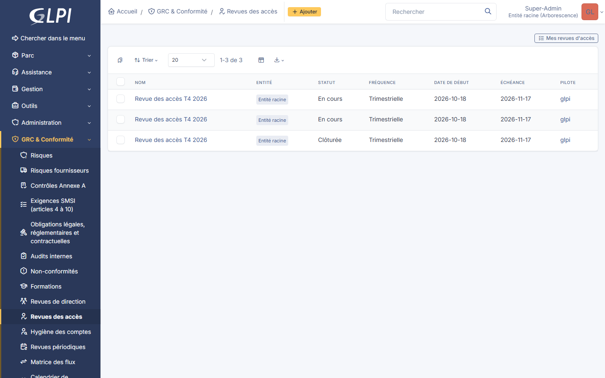
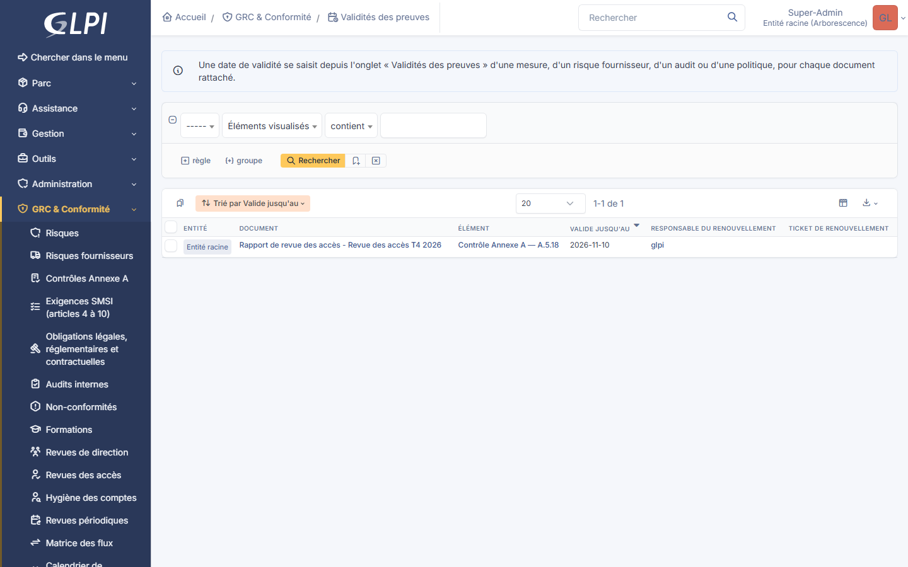
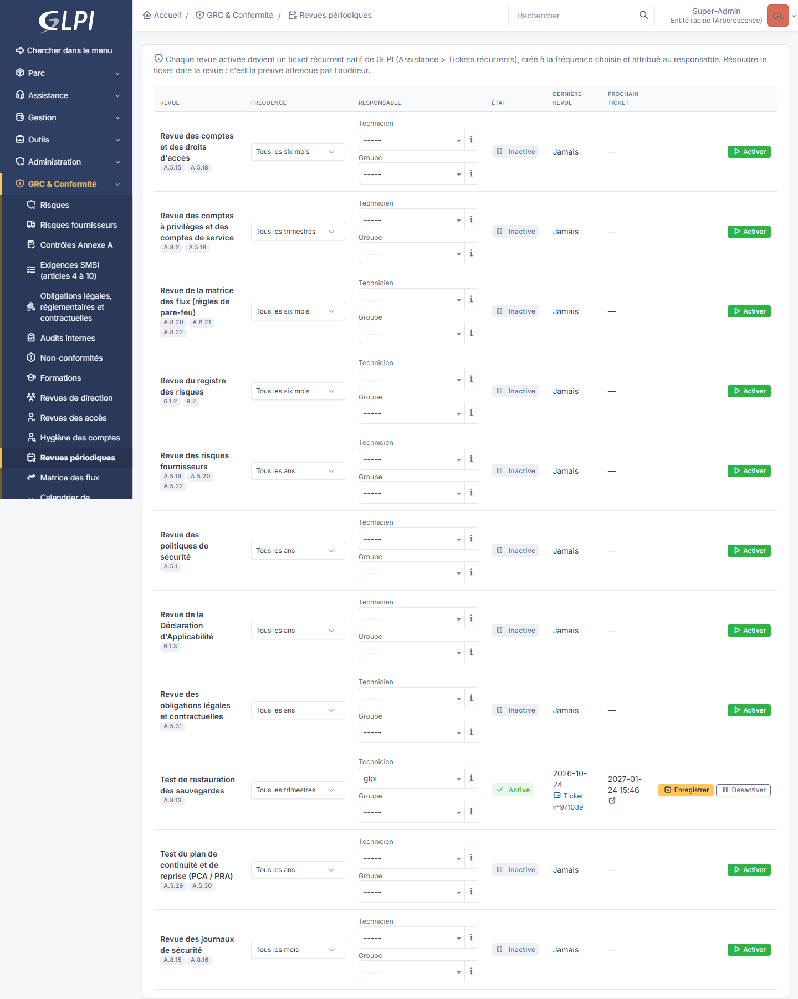
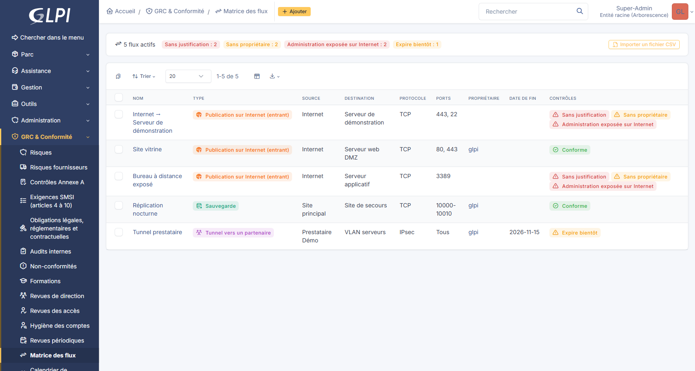
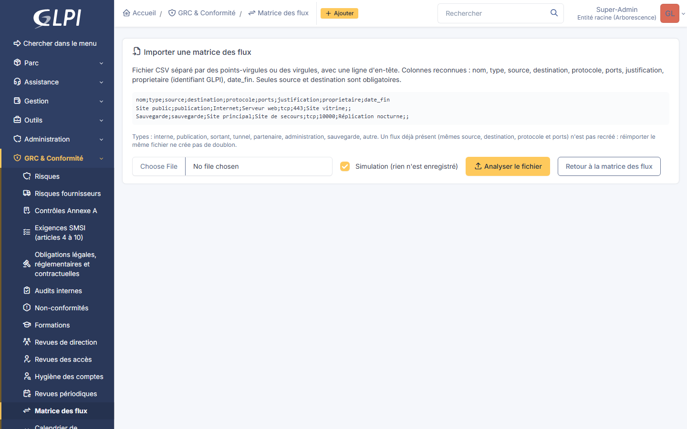
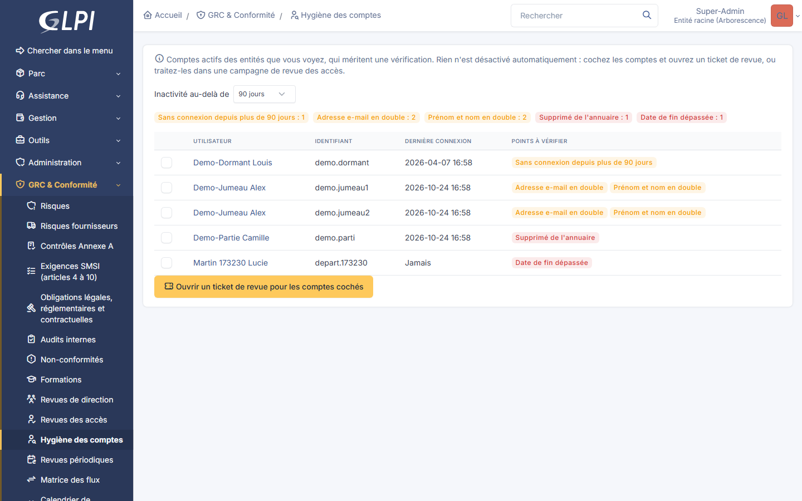
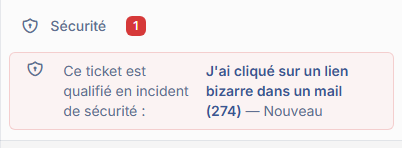
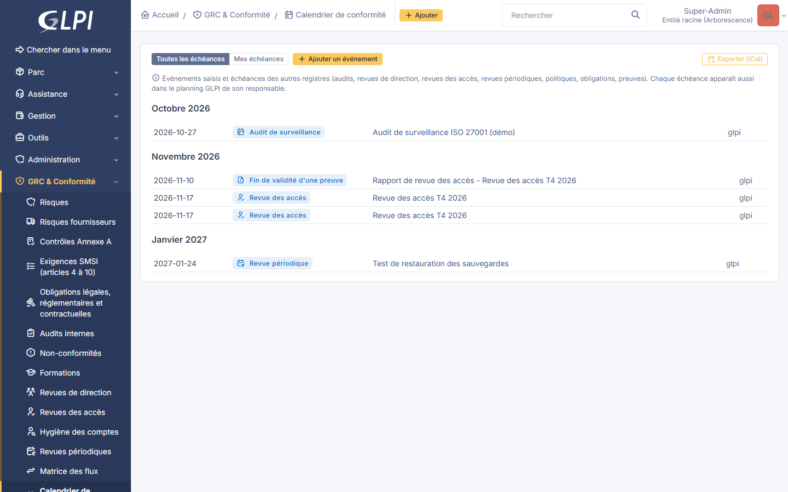
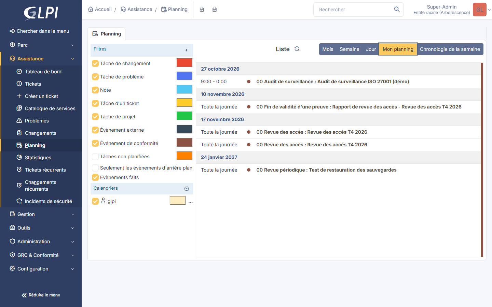

[🇫🇷 Français](#-français) · [🇬🇧 English](#-english)

## 🇫🇷 Français

**Tutoriel : Utilisation de GLPI GRC Manager**

Ce tutoriel parcourt le flux complet du plugin sur une instance GLPI 11 réelle : de l'activation
jusqu'au tableau de bord, en passant par le registre de risques génériques, la matrice
probabilité x impact, la Déclaration d'Applicabilité (SoA), le programme d'audit interne avec ses
actions correctives et préventives (CAPA), le registre de risques fournisseurs/tiers, le suivi des
formations, les revues de direction, le tableau de bord ISMS créé automatiquement à l'installation
et le suivi de version du plugin. Toutes les captures ci-dessous viennent d'une instance réelle,
avec de vraies données (exemples anonymisés).

### Étape 1 : Installer et activer le plugin

Le plugin s'installe comme n'importe quel plugin GLPI (voir le
[README.md](../README.md#installation) pour la procédure complète). Une fois le code en place,
depuis **Configuration > Plugins**, la ligne "GLPI GRC Manager" affiche son statut "Activé" une
fois l'installation et l'activation terminées.

Le plugin ajoute son propre menu **GRC & Conformité**, en six rubriques (Tableau de bord, Risques,
Conformité, Audits et amélioration, Opérations, Sécurité technique) ; les écrans d'une même rubrique
sont réunis par une barre d'onglets. Les incidents de sécurité sont dans le menu **Assistance**.

### Étape 2 : Créer un risque dans le registre générique

Depuis **GRC & Conformité > Risques**, la liste est vide tant qu'aucun risque n'a été créé.

Un nouveau risque demande un titre, une catégorie (humain/processus/physique/tiers-fournisseur/
technique), une probabilité et un impact.

Une fois enregistré, le niveau de risque (faible/moyen/élevé/critique) et le score numérique sont
calculés automatiquement à partir de la probabilité et de l'impact, selon la matrice configurée
(voir étape 3).

Le propriétaire du risque peut ensuite fixer une décision de traitement (accepter/mitiger/
transférer/éviter) accompagnée d'une justification.

La liste affiche ensuite chaque risque avec des badges colorés pour la catégorie, le niveau de
risque, l'impact et le traitement.

### Étape 3 : Configurer la matrice probabilité x impact

Depuis **Configuration > Plugins**, l'icône en forme de clé sur la ligne du plugin ouvre l'écran
de configuration de la matrice de risque : chaque combinaison probabilité/impact peut être
associée au niveau de risque de son choix (faible/moyen/élevé/critique), avec un aperçu coloré
mis à jour en direct. Les valeurs par défaut reproduisent le comportement du registre avant que
cet écran n'existe : aucun risque existant ne change de niveau tant que la grille n'est pas
modifiée.

**Taille de la matrice (4 x 4 ou 5 x 5).** La matrice est en 4 x 4 par défaut. Sous la grille,
« Taille de la matrice » permet de passer en 5 x 5 (très rare, rare, possible, probable, quasi
certaine ; négligeable, faible, moyen, élevé, critique), ou de revenir en 4 x 4. Le changement se
fait en deux étapes, sans rien modifier avant la confirmation :

1. **Correspondance des valeurs** : pour chaque probabilité et chaque impact utilisés aujourd'hui,
   le nombre de risques concernés et la nouvelle valeur proposée (celle qui change le moins de
   niveaux de risque), modifiable ;
2. **Vérifier l'effet et appliquer** : nombre de risques mis à jour, niveaux qui montent ou
   baissent, grille de la nouvelle taille ; une case à cocher confirme la vérification.

Les risques et les risques fournisseurs sont alors convertis ; l'historique de chaque risque garde
l'ancienne et la nouvelle valeur, avec un message qui explique la conversion. Le niveau de risque
reste sur quatre valeurs (faible, moyen, élevé, critique) : l'appétence, les indicateurs et les
contrôles de cohérence ne changent pas. Ce changement demande le droit de modifier la
configuration du plugin et les registres sensibles. Les échelles des études EBIOS RM et des AIPD
ne sont pas concernées.

### Étape 4 : Parcourir la Déclaration d'Applicabilité (SoA)

Depuis **GRC & Conformité > Conformité**, les 93 mesures réelles de l'Annexe A ISO/IEC 27001:2022
sont listées, préchargées à l'installation et marquées "Applicable" par défaut (clause 6.1.3).

La liste peut être filtrée par thème (Organisationnel, Humain, Physique, Technologique) grâce au
formulaire de recherche natif de GLPI.

Chaque contrôle s'ouvre pour ajuster son applicabilité (applicable/non applicable/partiellement
applicable) et son état de mise en œuvre.

Dès que l'applicabilité passe à "Non applicable" ou "Partiellement applicable", une justification
devient obligatoire (clause 6.1.3 d) : tenter d'enregistrer sans la renseigner affiche une erreur
et bloque l'enregistrement.

Une fois la justification renseignée, l'enregistrement réussit.

**Motifs de sélection et mesures compensatoires.** Sous la justification, cochez pourquoi la mesure
est retenue : résultat de l'appréciation des risques, obligation légale ou réglementaire, exigence
contractuelle, attente d'une partie intéressée, bonne pratique (plusieurs motifs possibles). Tant
que personne ne les a renseignés, les motifs déduits des liens sont déjà cochés, avec la mention
« D'après les liens » : un risque lié coche l'appréciation des risques, une obligation du registre
rattachée à ce risque coche le motif légal ou contractuel. Vous pouvez les décocher. Pour une
mesure non applicable ou partiellement applicable, quatre champs apparaissent : catégorie
d'exclusion (activité absente, assurée par un prestataire certifié, hors du périmètre du SMSI),
mesures compensatoires choisies parmi les autres mesures de la même SoA, description libre et
risque résiduel. Exemple fictif : A.7.4 non applicable, aucun local propre, hébergement chez un
prestataire certifié ; mesure compensatoire A.5.20 (clause d'audit du contrat). La justification
reste obligatoire. Ces informations figurent dans la liste (filtres « Motifs de sélection »,
« Catégorie d'exclusion », « Risque résiduel »), dans l'export CSV et dans le PDF, avec une synthèse
par thème (mesures applicables, exclues, mises en œuvre, en cours, planifiées). Une SoA déjà
approuvée n'est pas modifiée : ce que vous ajoutez entre dans la version suivante à faire approuver.

### Étape 5 : Créer un audit et une non-conformité, jusqu'à la clôture CAPA

Depuis **GRC & Conformité > Audits et amélioration**, la liste est vide tant qu'aucun audit n'existe.

Un audit se définit par un titre, un statut, une date planifiée et un périmètre libre.

Les documents de l'audit (plan d'audit, preuves collectées, rapport signé) et de ses constats ne se
lisent que par son **équipe** : l'auditeur et le responsable de la fiche, les membres ajoutés dans
l'onglet **Équipe** (auditeurs, ou audités en lecture seule) et le **groupe RSSI** choisi dans la
configuration du plugin. Le droit Documents de GLPI ne suffit pas. L'onglet **Accès aux documents**
liste chaque téléchargement (date, utilisateur, document) et l'onglet **Notes** garde les notes de
travail datées, avec leur auteur.

**Audit interne selon l'ISO 19011** (ISO 27001 9.2) :

1. **Programme pluriannuel** : la page **Programme d'audit pluriannuel** de la rubrique présente les
   processus du SMSI (les activités de la matrice des responsabilités) par année du cycle de
   certification (3 ans, année de départ choisie sur la page). Un processus en rouge n'a aucun audit
   sur le cycle, en orange son audit est en retard. Les exigences du SMSI qu'aucune grille d'audit du
   cycle ne couvre sont aussi signalées.
2. **Processus audités** : dans l'onglet **Programme et indépendance** de l'audit, choisissez les
   processus qu'il audite.
3. **Indépendance** : un auditeur (celui de la fiche ou un auditeur de l'équipe) qui réalise ou
   approuve un processus audité dans la matrice des responsabilités, en son nom ou par un groupe, est
   en conflit. L'audit ne peut être ni démarré ni terminé tant que chaque conflit n'a pas de
   justification, conservée avec son auteur, sa date et dans l'historique de l'audit.
4. **Compétence** : choisissez sur la page du programme les formations qui qualifient un auditeur
   interne (par exemple « Auditeur interne ISO 27001 »). L'onglet **Équipe** indique alors pour
   chaque auditeur s'il est qualifié, si sa qualification est à renouveler ou s'il n'en a aucune.
5. **Remise du rapport à la direction** : saisissez la date de remise et le destinataire dans le même
   onglet. Ils figurent dans le dossier de revue de direction (9.3.2 d 3).
6. **Objectifs et critères** : sur la fiche de l'audit, renseignez ses **Objectifs** (ce que l'audit
   doit établir) et ses **Critères d'audit** (articles de la norme, politiques, procédures auxquels
   les preuves sont comparées), à côté du périmètre.
7. **Points de contrôle** : l'encadré **Points de contrôle de l'audit**, en tête de l'onglet
   **Programme et indépendance**, indique en couleur ce que l'auditeur de certification vérifiera :
   objectifs, périmètre et critères définis, processus choisis, auditeurs désignés, qualifiés et
   indépendants, rapport remis à la direction. La page du programme reprend ces points pour chaque
   audit du cycle et signale les audits incomplets. Le rapport PDF de l'audit les reprend aussi, avec
   la compétence des auditeurs et la justification de chaque conflit.
8. **Indépendance par les mesures auditées** : un processus dont la matrice des responsabilités porte
   une mesure de l'Annexe A auditée (ligne « mesure » de la grille de l'audit, ou mesure liée sur la
   fiche) est contrôlé aussi, même s'il n'est pas choisi dans l'onglet. Le conflit indique les
   mesures concernées (« Par les mesures auditées A.8.13 ») et se justifie de la même façon.
9. **Planifier depuis le programme** : sur la page du programme, le bouton **Planifier** d'une case
   sans audit à venir (cette année ou une année suivante) crée un audit interne pour ce processus et
   cette année, dans l'entité du processus, et ouvre sa fiche. Complétez ensuite ses objectifs, son
   périmètre, ses critères et ses auditeurs.

Depuis l'onglet **Non-conformités** de la rubrique, une non-conformité peut être liée à cet audit interne, avec
une sévérité, une échéance, une description et une cause racine.

Le cycle CAPA (clause 10.2 ISO/IEC 27001:2022) impose une action corrective avant de pouvoir
clôturer ou vérifier une non-conformité : tenter de passer au statut "Vérifiée" sans action
corrective renseignée bloque l'enregistrement.

Une fois l'action corrective (et, le cas échéant, l'action préventive) renseignée, la
non-conformité peut être vérifiée : la date de vérification de clôture est alors automatiquement
renseignée à la date du jour si elle est restée vide.

#### Audits de certification et constats de l'organisme

Un audit est **interne** (article 9.2) ou mené par l'**organisme de certification** : champ
**Type d'audit** (audit de certification initial, audit de surveillance 1 ou 2, audit de
renouvellement). Pour un audit de certification, la fiche demande l'organisme (un fournisseur GLPI,
**Gestion > Fournisseurs**), l'auditeur responsable et le référentiel avec son édition (par exemple
ISO/IEC 27001:2022). Les audits existants restent des audits internes.

Dans l'onglet **Constats** d'un audit de certification, chaque constat se saisit avec le
vocabulaire de l'organisme : **non-conformité majeure**, **non-conformité mineure**, **point
sensible** ou **piste de progrès**, avec la référence de l'organisme (par exemple GVE-36), le
processus audité, la clause ou la mesure et le site (un lieu GLPI). Le traitement est le même que
pour une non-conformité interne (cause, action corrective, responsable, échéance, preuves dans
l'onglet **Documents**, vérification) ; l'action corrective n'est obligatoire que pour une
non-conformité.

L'écran **Audits et amélioration > Constats des audits précédents** liste les constats de chaque
audit de certification avec leur état de levée (non levé, action en cours, action réalisée à
vérifier, levé) et leurs preuves. Il se filtre par audit ou sur les seuls constats non levés, et
s'exporte en PDF : c'est le document à remettre à l'auditeur à la réunion d'ouverture de l'audit
suivant. La **Préparation à la certification** rappelle, dans l'étape « Traiter les
non-conformités », le nombre de constats précédents non levés.

La liste des audits affiche la colonne **Type d'audit** juste après le titre.

### Étape 6 : Ajouter les indicateurs à un tableau de bord

Le plugin ajoute ses propres cartes à l'éditeur de tableau de bord natif de GLPI : aucun écran à
part. Depuis un tableau de bord, mode édition, cliquer sur une case vide ouvre "Ajouter une
carte" : les cartes du plugin apparaissent groupées sous "GRC Manager" (risques ouverts par
niveau et par catégorie, contrôles SoA revus et par applicabilité, non-conformités ouvertes,
actions correctives/préventives en retard, audits par statut...).

Une fois ajoutée, la carte affiche la donnée réelle, ici le nombre de risques ouverts du
registre.

### Étape 7 : Créer un risque dans le registre fournisseurs/tiers

Depuis **GRC & Conformité > Risques > Risques fournisseurs**, la liste affiche les risques fournisseurs déjà
enregistrés sur cette instance.

Un nouveau risque fournisseur reprend exactement les mêmes champs catégorie/probabilité/impact
que le registre générique (voir étape 2), avec en plus un fournisseur GLPI natif (itemtype
`Supplier` du cœur GLPI) obligatoire : ce registre couvre la dépendance à un tiers (clause
6.1.2/8.2, Annexe A.5.19-A.5.22).

Comme pour le registre générique, le niveau de risque et le score sont calculés automatiquement
à l'enregistrement, selon la même matrice probabilité x impact configurée à l'étape 3.

Le même cycle de décision de traitement (accepter/mitiger/transférer/éviter) et de justification
que le registre générique s'applique ensuite.

La liste affiche ensuite chaque risque fournisseur avec le fournisseur GLPI lié et les mêmes
badges colorés que le registre générique.

### Étape 8 : Suivre une formation et la réalisation par participant

Depuis **GRC & Conformité > Opérations > Formations**, la liste affiche les sessions déjà enregistrées.

Une formation se définit par un titre, un format (présentiel/e-learning/autre), une date de
réalisation, un public cible, un caractère obligatoire ou non et, le cas échéant, une périodicité
de renouvellement en mois (clauses 7.2 « compétence » et 7.3 « sensibilisation »). Les
participants, de vrais utilisateurs GLPI, sont sélectionnés dans le même formulaire.

Une formation donnée plusieurs fois a plusieurs **sessions** : depuis l'onglet **Sessions** de la
formation, « Ajouter une session » ouvre un formulaire prérempli (titre, format, note maximale,
seuil) où l'on renseigne la date, le formateur, le lieu ou le lien et les participants. Chaque
session garde ses propres documents (feuille d'émargement, support, quiz) ; l'onglet liste les
sessions avec leur taux de réussite, et le taux de réussite de la formation, toutes sessions.

L'onglet **Copies de quiz** d'une session reçoit la copie corrigée de chaque participant. Une copie
est une donnée personnelle : seuls le participant, le formateur de la session et le groupe RSSI la
lisent, et chaque téléchargement est historisé. Le participant retrouve ses formations, ses notes et
ses copies dans l'onglet **Mes formations** de ses préférences, sans droit sur le plugin.

Une fois enregistrée, un tableau de suivi individuel apparaît sous le formulaire : un statut de
réalisation (en attente/terminée/dispensé) et une date par participant.

Faire passer un participant au statut « Terminée » avec sa date de réalisation, puis enregistrer :
son suivi individuel est à jour, et la formation compte désormais dans le taux de réalisation
affiché au tableau de bord (voir étape 10).

### Étape 9 : Enregistrer une revue de direction

Depuis **GRC & Conformité > Audits et amélioration > Revues de direction**, la liste affiche les revues déjà enregistrées.

Une revue de direction (clause 9.3) se définit par un titre, un statut (planifiée/terminée), des
participants, un ordre du jour et les décisions/actions qui en ressortent. Si le statut est
positionné à « Terminée » sans indiquer de date de revue, celle-ci est automatiquement renseignée
à la date du jour lors de l'enregistrement.

### Étape 10 : Consulter le tableau de bord ISMS par défaut

Depuis la v1.0.0, l'installation du plugin crée automatiquement un tableau de bord natif GLPI
« GRC Manager - Vue d'ensemble ISMS », visible par tout utilisateur disposant du droit natif
« Tableaux de bord » (sélecteur en haut de n'importe quel tableau de bord GLPI) : une installation
fraîche affiche d'emblée une vue d'ensemble ISMS au lieu d'un écran vide à composer soi-même. Il
reprend les mêmes cartes KPI du plugin déjà présentées à l'étape 6, organisées en une rangée de
chiffres clés, une rangée d'indicateurs de progression, puis des répartitions par registre.

### Étape 11 : Suivre la version du plugin

Depuis **Configuration > Plugins**, l'icône en forme de clé ouvre le même écran de configuration
qu'à l'étape 3 (matrice de risque) : une carte en haut de l'écran compare désormais la version
installée à la dernière version publiée sur GitHub (mise en cache 24 h), avec un badge orange en
cas d'écart et vert lorsque l'instance est à jour.

---

> Les étapes 12 à 18 ont été capturées sur GLPI 12 avec la version 2.6.0 (données fictives). Depuis
> la 2.0, les écrans du plugin sont regroupés dans le menu **GRC & Conformité**.

### Étape 12 : Lancer une campagne de revue des accès

Depuis **GRC & Conformité > Opérations > Revues des accès**, une campagne liste les comptes à revoir et les
confie à leurs responsables (supérieur hiérarchique, responsable de groupe ou pilote). Chaque
responsable traite ses lignes depuis **Mes revues d'accès** : conserver, modifier ou retirer. Un
droit à retirer devient un ticket ; le plugin ne retire jamais un droit lui-même. À la clôture, un
rapport PDF est joint à la campagne et à la mesure de l'Annexe A concernée.

### Étape 13 : Dater la validité des preuves

Sur une mesure, un risque fournisseur, un audit ou une politique, l'onglet **Validités des
preuves** donne une date de fin de validité à chaque document rattaché (certificat, rapport,
attestation). Le responsable est prévenu 30 jours avant ; à l'expiration, un ticket « Renouveler la
preuve » est ouvert. **GRC & Conformité > Conformité > Preuves** les rassemble toutes.

### Étape 14 : Planifier les revues périodiques

**GRC & Conformité > Opérations > Revues périodiques** propose onze revues (droits d'accès, comptes à
privilèges, matrice des flux, registre des risques, fournisseurs, politiques, SoA, obligations,
tests de restauration et de PCA, journaux de sécurité). **Activer** une revue crée un ticket
récurrent GLPI attribué au responsable choisi, avec sa check-list. Quand le ticket est résolu, la
date de la dernière revue s'affiche : c'est la preuve attendue par l'auditeur. Une revue non faite
sur sa période passe « En retard ».

### Étape 15 : Tenir la matrice des flux réseau

**GRC & Conformité > Sécurité technique > Matrice des flux** recense les flux autorisés : source et destination (un
actif GLPI ou un réseau, une zone, une adresse), protocole, ports, justification, propriétaire et
date de fin. Les contrôles automatiques signalent les flux sans justification ou sans propriétaire,
expirés, et les services d'administration publiés sur Internet.

Une matrice existante s'importe en CSV, avec une simulation qui n'écrit rien ; réimporter le même
fichier ne crée pas de doublon.

### Étape 16 : Vérifier l'hygiène des comptes

**GRC & Conformité > Opérations > Hygiène des comptes** liste les comptes actifs à vérifier : supprimés de
l'annuaire, date de fin dépassée, sans connexion depuis N jours ou jamais utilisés, en double.
Cochez les comptes et ouvrez un ticket de revue ; aucun compte n'est désactivé automatiquement.

### Étape 17 : Escalader un ticket en incident de sécurité

Sur un ticket classique (« j'ai cliqué sur un lien bizarre »), la section **Sécurité** du panneau
de droite propose **Escalader en incident de sécurité** : l'incident reprend le titre, la
description, le demandeur et les éléments liés, et le ticket garde son statut. Une fois qualifié,
la section affiche le lien vers l'incident. L'action existe aussi en action groupée sur la liste
des tickets.

### Étape 18 : Suivre le calendrier de conformité

**GRC & Conformité > Tableau de bord > Calendrier de conformité** réunit les événements saisis (audit de
certification ou de surveillance, test d'intrusion, exercice de crise…) et les échéances des autres
registres : audits, revues de direction, revues des accès, revues périodiques, politiques,
obligations, preuves. Il s'exporte en iCal.

Chaque échéance apparaît aussi dans le **planning GLPI** de son responsable, en lecture seule.

### Étape 19 : Découper le SMSI par entité (périmètres)

Avec plusieurs entités GLPI (par exemple « Filiale Nord » et « Filiale Sud » sous l'entité racine),
chaque risque appartient à une entité : un utilisateur limité à Filiale Nord ne voit que les risques
de Filiale Nord. Pour qu'une filiale tienne sa propre Déclaration d'Applicabilité :

1. Choisissez l'entité Filiale Nord dans le sélecteur d'entité de GLPI.
2. Ouvrez Conformité > Contrôles Annexe A : l'encadré indique « Filiale Nord suit la SoA de Entité
   racine ». Cliquez sur **Créer la SoA de cette entité** et confirmez.
3. Les 93 mesures de Filiale Nord reprennent l'applicabilité et les justifications de la SoA commune ;
   revoyez-les une à une, puis demandez l'approbation de la direction comme pour la SoA commune.
4. Revenez à l'entité racine en vue arborescente : Tableau de bord > **Périmètres** compare les deux
   filiales (SoA suivie, taux de mise en œuvre, version approuvée, risques ouverts par niveau,
   non-conformités ouvertes par gravité).
5. Les audits suivent la même logique : créé dans Filiale Nord, un audit, ses constats et ses demandes
   de preuves ne sont visibles que de Filiale Nord (et de l'entité racine en vue arborescente). Les
   listes de l'équipe, des preuves et de l'accès auditeur ne proposent que les comptes qui ont un
   profil dans Filiale Nord. Les actions de traitement d'un risque suivent l'entité du risque.

### Étape 20 : Décrire le contexte de l'organisation (articles 4.1 et 4.2)

1. Ouvrez Conformité > **Contexte de l'organisation**. L'encadré « À quoi sert cette page ? » rappelle
   ce qui est attendu.
2. Cliquez sur **Répondre à la question** dans l'encadré du changement climatique : dites s'il est
   pertinent (« Retenu par le SMSI ») ou non (« Non retenu ») et écrivez pourquoi. Tant que ce n'est
   pas fait, l'exigence 4.1 ne peut pas passer à « Conforme ».
3. **Ajouter un enjeu** : par exemple « Nouvelle loi cyber », externe, catégorie réglementaire, avec
   son effet sur le SMSI et les risques liés.
4. **Ajouter une partie intéressée** : par exemple « Clients grands comptes », type client, qui
   attendent une notification d'incident sous 24 h. Choisissez « Retenu par le SMSI », écrivez
   l'exigence retenue, puis liez l'obligation contractuelle et la mesure A.5.24. Une partie peut être
   un fournisseur ou un groupe déjà enregistré dans GLPI.
5. Donnez un propriétaire et une date de revue : il reçoit un rappel 30 jours avant. La première
   fiche fait passer l'exigence 4.1 (enjeu) ou 4.2 (partie) de « Non commencé » à « En cours ».
6. La fiche d'une revue de direction résume le contexte : nombre d'enjeux et de parties, fiches
   modifiées depuis la revue précédente, revues dépassées. Pour l'auditeur, exportez la liste
   (CSV ou PDF) avec le bouton d'export de GLPI.

### Étape 21 : Décrire les compétences requises et suivre les écarts (article 7.2)

1. Ouvrez la rubrique Revue des accès > **Compétences**. Cliquez sur **Ajouter les fonctions par
   défaut manquantes** : RSSI, DPO, direction, administrateur, développeur, technicien et tout le
   personnel arrivent avec leurs compétences requises (niveau attendu et façon de l'acquérir).
2. Ouvrez une fonction, par exemple « Administrateur systèmes et réseaux ». Décrivez sa mission, puis
   indiquez qui l'exerce : un utilisateur, un groupe (par exemple « Équipe infrastructure ») ou un
   titre de GLPI (par exemple « Technicien / Technicienne », tel que créé par le plugin Configuration
   GLPI Auto). Ajustez les compétences requises si besoin.
3. Dans le **Catalogue des compétences**, ouvrez une compétence et liez les formations du plugin qui
   la donnent, avec le niveau atteint. Une personne qui réussit la formation (ou l'une de ses
   sessions) acquiert la compétence ; si la formation se renouvelle, la compétence expire avec elle.
4. Pour un certificat, un diplôme ou l'expérience constatée à l'entretien annuel, utilisez
   **Déclarer une compétence avec sa preuve** : la référence de la preuve est obligatoire, et le
   fichier se joint dans l'onglet Documents (il ne se lit qu'avec les droits de la déclaration).
5. La matrice **Personnes et compétences** montre, pour chaque titulaire, le niveau acquis et le
   niveau attendu. Sous la matrice, chaque écart propose une action : la formation à planifier, ou
   la preuve à déclarer. Rien n'est modifié automatiquement.
6. Chaque fonction a sa **fiche de poste sécurité** en PDF. Avant l'audit, cliquez sur **Archiver
   comme preuve** : le dossier daté (fiches de poste et écarts) est joint à l'exigence 7.2, dont la
   fiche résume l'état des compétences.
7. Chacun retrouve ses propres compétences dans ses préférences (onglet « Mes compétences »). Le
   responsable voit la matrice et l'onglet « Compétences » de chaque utilisateur, avec le droit du
   plugin et la lecture des utilisateurs, pour les personnes de ses entités.
### Étape 22 : Tenir le registre des contacts officiels (mesures A.5.5 et A.5.6)

1. Ouvrez Conformité > **Contacts officiels** (onglet à côté de « Contexte de l'organisation »).
   L'encadré « À quoi sert cette page ? » rappelle ce qui est attendu.
2. Cliquez sur **Ajouter un contact officiel**. La fiche est une partie intéressée du contexte, déjà
   cochée « Contact officiel » : il n'y a pas de second registre à tenir. Une partie existante (un
   assureur, un hébergeur enregistré comme fournisseur) devient un contact officiel en cochant la
   case sur sa fiche.
3. Renseignez par exemple « Autorité de protection des données (fictive) » : catégorie « Autorité de
   contrôle », coordonnées (téléphone, formulaire en ligne), **quand le contacter** (« Violation de
   données présentant un risque pour les personnes, RGPD article 33 »), **délai** (« 72 heures »),
   l'interlocuteur interne habilité (le DPO) et, en secours, un groupe (la cellule de crise). Cochez
   « À contacter pour une violation de données personnelles ».
4. Ajoutez de même le CSIRT national et la police (cochez « À contacter pour un incident de
   sécurité »), votre assureur et les groupes d'intérêt que vous suivez (catégorie « Groupe
   d'intérêt », preuve de la mesure A.5.6).
5. Après avoir vérifié les coordonnées, cliquez sur **Enregistrer la vérification** : la date et
   votre nom sont conservés dans l'historique. Un contact non vérifié depuis 12 mois est signalé dans
   le registre, et son propriétaire reçoit une relance (au plus une fois par mois).
6. Cliquez sur **Imprimer le registre (PDF)** et gardez la copie avec le plan de gestion de crise :
   elle reste utilisable si GLPI est indisponible.
7. Depuis un incident de sécurité ou une violation de données, l'onglet **Contacts officiels** affiche
   les contacts à prévenir, avec le délai et la personne habilitée. Seuls les contacts de l'entité de
   l'incident ou d'une entité parente (fiche visible des sous-entités) sont proposés.
8. Sur la fiche des mesures A.5.5 et A.5.6 de la SoA, le cadre « Registre des contacts officiels »
   montre le nombre de contacts, vérifiés ou à vérifier, les prises de contact tracées depuis
   12 mois, avec le lien vers le registre et son PDF.
9. Renseignez aussi le **délai en heures** du contact (72 pour l'autorité de protection des données,
   24 pour l'alerte précoce du CSIRT) : l'onglet **Contacts officiels** d'un incident ou d'une
   violation affiche alors l'échéance de chaque contact, comptée depuis la détection de l'incident
   ou la prise de connaissance de la violation.
10. Quand vous avez appelé ou écrit au contact, cliquez sur **Tracer une prise de contact** sur sa
    ligne : date et heure, référence du dossier (par exemple « DOSSIER-FICTIF-001 »), commentaire.
    Si vous décidez qu'il n'avait pas à être prévenu, choisissez « Non nécessaire (décision) » et
    donnez le motif. Le badge passe à « Prévenu dans le délai », « Prévenu en retard » ou « Non
    nécessaire (décision tracée) ». Rien n'est envoyé depuis le plugin.
11. La fiche du contact a un onglet **Prises de contact tracées** : l'historique de vos relations
    avec cette autorité ou ce groupe d'intérêt, à montrer à l'auditeur.

### Étape 23 : Vérifier les licences logicielles (mesure A.5.32)

Le plugin lit les logiciels et les licences déjà enregistrés dans GLPI (Parc > Logiciels, onglet
Licences) ; il ne modifie rien. Il faut le droit « Registres sensibles » du plugin, et les droits
natifs de lecture des logiciels et des licences.

1. Ouvrez Sécurité technique > **Licences logicielles**. L'encadré « À quoi sert cette page ? »
   rappelle ce qui est attendu.
2. En bas de la page, vérifiez la liste des **éditeurs commerciaux surveillés** (Microsoft, Adobe,
   Oracle, Autodesk...) : c'est le champ « Fabricant » du logiciel dans GLPI. La seconde liste
   écarte les outils gratuits de ces éditeurs (« Redistributable », « Acrobat Reader »...). Seule
   une personne qui peut modifier la configuration du plugin change ces listes.
3. Les compteurs donnent le nombre de constats, regroupés ensuite par entité :
   - **Logiciel commercial sans licence** : un logiciel d'un éditeur surveillé est installé, et
     aucune licence ne compte pour cette entité. Une licence compte pour une entité si elle lui
     appartient, ou si elle est récursive et appartient à une entité parente.
   - **Plus d'installations que de postes licenciés** : par exemple 12 ordinateurs équipés pour une
     licence de 10 postes. Une licence illimitée (nombre 0 ou moins) couvre tout ; une licence
     expirée ne compte plus. Une licence récursive est partagée par les sous-entités : la mention
     « Partagée avec les sous-entités » compte leurs installations ensemble.
   - **Licence expirée encore utilisée** : des ordinateurs y sont encore affectés, ou le logiciel
     reste installé sans autre licence valable.
   - **Licence arrivant à échéance** (rappel, pas un écart) : une licence utilisée expire dans les
     60 prochains jours et aucun renouvellement n'est saisi. Réglez ce délai en bas de la page
     (« Alerter avant l'échéance d'une licence », 0 pour désactiver).

   Le badge **Dépassement autorisé** signale un surdéploiement sur une licence qui l'autorise : il
   reste à régulariser auprès de l'éditeur. Au-dessus des constats, la **couverture des licences**
   donne la part des logiciels commerciaux surveillés installés qui ont une licence valable.
4. Pour chaque constat, ouvrez le logiciel ou la licence (liens) et corrigez dans GLPI : saisissez
   la licence achetée, ajoutez des postes, désinstallez le logiciel, ou renouvelez la licence et
   déplacez les ordinateurs affectés.
5. Cliquez sur **Export (CSV)** pour remettre la liste à l'auditeur.
6. Sur la fiche de la mesure A.5.32 de la SoA, le cadre « Conformité des licences logicielles »
   montre les compteurs, les licences arrivant à échéance et la couverture des licences ; les
   contrôles de cohérence du SMSI (onglet du tableau de bord) listent chaque écart.
### Étape 24 : Préparer l'audit de certification avec une date cible

1. Ouvrez Tableau de bord > **Préparation à la certification**. L'encadré « À quoi sert cette page ? »
   rappelle ce qui est attendu.
2. Donnez une **date cible** : soit dans le cadre « Réglages de la préparation à la certification »
   (par exemple le 3 décembre), soit en planifiant l'audit lui-même. Un audit dont le type est
   « Audit de certification initial », « Audit de surveillance 1 ou 2 » ou « Audit de renouvellement », ou un
   événement du calendrier de conformité de même nature, est repris automatiquement : rien à saisir
   deux fois.
3. Chaque étape non faite reçoit une **échéance conseillée**, calculée en remontant depuis la date
   cible (le socle d'abord, puis l'audit interne, la revue de direction et le traitement des
   non-conformités). Une étape dont l'échéance tombe dans les 14 jours est marquée « Risque de
   retard » ; une échéance dépassée est signalée en rouge. Ce délai d'alerte se règle dans le champ
   « Alerte (jours) », et le bouton « Délais conseillés par étape » ouvre le tableau du nombre de
   jours avant la date cible de chaque étape (par exemple audit interne 60 jours, revue de direction
   30 jours avant un audit le 15 mars). Un délai réglé à l'envers de l'ordre logique (revue de
   direction conseillée avant l'audit interne) est signalé, jamais corrigé à votre place.
4. Choisissez le **responsable de la préparation** (à défaut, le responsable de l'audit cible). La
   tâche automatique `certificationreadiness` lui envoie la notification « Étape de la certification
   à risque » quand une étape approche ou dépasse son échéance, une seule fois par étape et par état.
   Rien n'est modifié automatiquement. Il doit pouvoir lire le plugin sur toutes les entités, puisque
   l'état couvre tout le SMSI.
5. Les échéances conseillées figurent dans le **calendrier de conformité** (et dans le planning du
   responsable), avec un lien vers l'étape à compléter.
6. Réglez au besoin les **seuils** : couverture visée du programme d'audit (100 % par défaut, sur les
   trois dernières années) et part des participants formés (80 % par défaut).
7. Une fois certifié, saisissez la **date de certification** (ou terminez l'audit initial de
   certification) : le cadre « Cycle de maintien » affiche les deux audits de surveillance annuels et
   le renouvellement à trois ans, la date cible suit le prochain d'entre eux, et les étapes à refaire
   chaque année (appréciation des risques, SoA, audit interne, revue de direction) sont mises en
   avant. Le découpage des audits internes sur le cycle reste dans le **programme d'audit
   pluriannuel**.
8. Les réglages demandent le droit de modifier le plugin ; la page reste lisible avec le droit de
   lecture.
### Étape 25 : Tenir le registre des procédures d'exploitation (mesure A.5.37)

1. Ouvrez Conformité > **Procédures d'exploitation** (onglet à côté de « Politiques de sécurité »).
   La page montre la couverture des domaines attendus : sauvegarde, restauration, supervision,
   journaux, mises à jour, déploiement, gestion des accès, gestion des incidents, changements,
   maintenance. Chaque domaine est « À jour », « Revue à faire », « Non approuvée » ou « Aucune
   procédure ».
2. Sur la ligne d'un domaine sans procédure, cliquez sur **Ajouter la procédure**. La fiche est un
   document de la bibliothèque des politiques, déjà en catégorie « Procédure d'exploitation » et
   dans le bon domaine : pas d'objet à part. Un document existant devient une procédure en
   choisissant cette catégorie sur sa fiche.
3. Renseignez par exemple « Procédure de sauvegarde des serveurs (fictive) », version 1.0, son
   responsable, et joignez le document dans l'onglet « Documents ». Faites-la approuver (statut
   « Approuvée » avec sa date, ou onglet « Approbation » si le circuit est activé), puis fixez la
   **prochaine revue** : sans date de revue, ou une fois la date passée, le domaine passe en « Revue
   à faire ».
4. Dans l'onglet **Prise de connaissance**, ajoutez au public les groupes ou profils qui exécutent la
   procédure (l'équipe d'exploitation, par exemple), puis lancez la campagne : le registre affiche
   ensuite le taux de lecture de la version en vigueur.
5. La liste des domaines se règle dans la configuration du plugin (cadre « Domaines attendus des
   procédures d'exploitation ») : décochez un domaine qui ne vous concerne pas, ajoutez les vôtres,
   un par ligne.
6. Avant l'audit, cliquez sur **Archiver sur la mesure A.5.37** : le registre est enregistré en PDF
   daté sur la mesure. **Imprimer le registre (PDF)** le télécharge sans l'enregistrer. Sur la fiche
   de la mesure A.5.37, le cadre « Registre des procédures d'exploitation » rappelle la couverture ;
   les procès-verbaux d'approbation et les rapports de prise de connaissance d'une procédure y sont
   archivés (ceux d'une politique restent sur A.5.1).
7. Le texte de la procédure peut être un **article de la base de connaissances** de GLPI : sur la
   fiche de la procédure, onglet « Base de connaissances », liez l'article (par exemple « Sauvegarde
   des serveurs : pas à pas (fictif) »). Le registre affiche l'article et les documents joints sous
   le titre ; une procédure sans article ni document porte le badge « Sans contenu ».
8. Chaque année, relisez la procédure avec son responsable. Si elle reste juste, cliquez sur
   **Enregistrer la revue** sur sa fiche : la date du jour et votre nom sont tracés, sans nouvelle
   version, et la prochaine revue passe à un an (ou à la date que vous avez saisie). Le registre
   affiche « Revue le … par … » et le journal d'audit garde chaque revue. Si elle a changé, préparez
   une nouvelle version.
9. Le contrôle de cohérence signale les domaines attendus sans procédure approuvée (règle A.5.37).

### Étape 26 : Suivre la fin de garantie du matériel (mesures A.7.13 et A.8.9)

Le plugin lit les informations financières déjà saisies dans GLPI (onglet « Gestion » d'un
ordinateur, d'un moniteur, d'un matériel réseau...) : la **date de début de garantie** et la
**durée de garantie** en mois. Il ne modifie rien. Il faut le droit « Registres sensibles » du
plugin, le droit natif de lecture des informations financières (« Gestion ») et celui de chaque
type de matériel.

1. Sur la fiche d'un ordinateur fictif, par exemple « PC-COMPTA-01 », ouvrez l'onglet **Gestion**
   et saisissez une date de début de garantie (01/01/2023) et une durée (36 mois). GLPI affiche
   la date de fin de garantie (01/01/2026).
2. Ouvrez Sécurité technique > **Vulnérabilités du parc**, puis descendez jusqu'à la carte **Fin
   de garantie du matériel**, sous la carte « Fin de support ». Quatre compteurs donnent le nombre
   de matériels dont la garantie est **expirée**, **proche de sa fin**, **en cours**, ou
   **inconnue** (pas de date ou pas de durée : jamais compté comme sous garantie). Une durée « À
   vie » compte comme sous garantie.
3. Le tableau croise le **type de matériel** et l'**entité** ; seules vos entités apparaissent.
   La liste dessous donne les matériels à traiter, avec un lien vers chaque fiche ; le bouton
   **Tout le matériel** les montre tous.
4. Le seuil de « fin proche » est celui de la fin de support (90 jours par défaut), réglé dans la
   configuration du plugin, cadre « Fin de support (endoflife.date) ». Il s'applique même si
   endoflife.date n'est pas activé.
5. Pour chaque garantie expirée, vérifiez qu'un contrat de maintenance couvre le matériel,
   renouvelez la garantie ou prévoyez le remplacement. Cliquez sur **Export (CSV)** pour remettre
   la liste à l'auditeur (un matériel par ligne, avec fabricant, modèle et dates).
6. Sur la fiche des mesures A.7.13 et A.8.9 de la SoA, le cadre « Fin de garantie du matériel »
   montre les compteurs ; les contrôles de cohérence du SMSI listent chaque matériel dont la
   garantie est expirée (règle « Matériels dont la garantie est expirée »).

### Étape 27 : Évaluer la sécurité physique des sites (mesures A.7.1 à A.7.14)

1. Les sites sont les **lieux de GLPI** (Configuration > Intitulés > Lieux) : créez par exemple
   « Siège fictif, 12 rue des Essais, Villefictive » et « Entrepôt fictif, 4 allée des Tests ». Aucun
   second référentiel des sites.
2. Ouvrez Conformité > **Sécurité physique**, puis **Évaluer un site**. Choisissez le site, la date
   et l'évaluateur (il recevra le rappel), liez la **politique de sécurité physique et
   environnementale** : elle reste un document de la bibliothèque des politiques.
3. Une fois l'évaluation enregistrée, l'onglet **Grille de sécurité physique** compte une ligne par
   mesure A.7.1 à A.7.14 (« Non applicable » d'office pour une mesure exclue de la SoA). Pour chaque
   ligne, cliquez sur **Renseigner** : état (conforme, partiellement conforme, non conforme, non
   applicable), constat, preuves examinées. Ajoutez les photos et procès-verbaux dans l'onglet
   « Documents » de l'évaluation, puis citez-les sur la ligne : ils ne se lisent qu'avec le droit de
   lire l'évaluation.
4. Pour une ligne partielle ou non conforme (« Porte de la baie serveur non verrouillée », par
   exemple), cliquez sur **Créer l'action** : une non-conformité pré-remplie s'ouvre (site, mesure,
   constat). Indiquez le responsable et l'échéance, puis **Ajouter** : le workflow CAPA habituel
   prend le relais et la ligne affiche l'action et son statut.
5. L'onglet **Zones du site** liste les zones (publique, contrôlée, sensible, local technique), leurs
   contrôles d'accès (badge, clé, digicode, vidéosurveillance...), les personnes autorisées et si les
   consignes d'accès sont affichées. Une zone sensible ou un local technique sans contrôle d'accès ou
   sans consignes est signalé.
6. Passez l'évaluation à **Terminée** : la prochaine évaluation est fixée 12 mois plus tard. La tâche
   automatique « reassessmentreminder » prévient l'évaluateur 30 jours avant, puis une fois par mois
   tant que le site n'est pas réévalué ; l'échéance figure aussi dans le calendrier de conformité. La
   réévaluation reprend les zones et montre, ligne par ligne, l'état de l'évaluation précédente.
7. La page **Sécurité physique** compare la dernière évaluation de chaque site, mesure par mesure,
   avec le score et l'échéance. Sur la fiche d'une mesure A.7.x de la SoA, le cadre « Sécurité
   physique des sites » donne l'état de la mesure sur chaque site. Le lieu de GLPI a aussi un onglet
   « Sécurité physique » avec l'historique de ses évaluations.
### Étape 28 : Préparer la communication de crise (mesure A.5.26, article 7.4)

1. Dans l'en-tête de la liste des incidents de sécurité, cliquez sur **Modèles de messages de
   crise**. Cinq modèles sont fournis : incident majeur (premier message interne et fin de crise),
   violation de données (information des personnes concernées), indisponibilité (message aux
   utilisateurs et aux clients) et rançongiciel (consignes au personnel). Adaptez-les à votre
   organisation : objet, texte, situation, étape et public.
2. Les **variables** s'écrivent entre accolades, par exemple `{reference}`, `{title}`,
   `{detection_date}`, `{affected_systems}` ou `{next_update}` : la fiche du modèle en donne la
   liste. Elles sont remplacées par les valeurs de l'incident quand le message est préparé ; une
   variable sans valeur devient « [à compléter] ».
3. Dans l'onglet **Liste de diffusion** du modèle, ajoutez les destinataires internes (utilisateurs
   et groupes GLPI) et externes. Les destinataires externes sont les **contacts officiels** de
   l'étape 22 (assureur, autorité, prestataire...) : enregistrez d'abord un destinataire absent dans
   le registre des contacts officiels. Un contact sans coordonnées, un utilisateur sans adresse
   électronique ou un groupe sans membre est signalé « Aucune adresse enregistrée ».
4. Pendant une crise, ouvrez l'incident (par exemple « Chiffrement du serveur de fichiers
   (fictif) »), onglet **Communication de crise**. Le modèle conseillé pour la situation de
   l'incident est proposé en premier ; l'objet et le texte sont déjà remplis. Relisez, remplacez
   chaque « [à compléter] », décochez les destinataires à ne pas prévenir, ajoutez au besoin d'autres
   destinataires (un par ligne).
5. Cliquez sur **Copier le message** et **Copier les adresses électroniques**, ou sur **Exporter
   (fichier .eml)** pour ouvrir un brouillon dans votre messagerie. **Le plugin n'envoie aucun
   courriel** : vous envoyez le message vous-même.
6. Une fois le message envoyé, cliquez sur **Tracer comme envoyé** (la date se corrige si
   l'envoi a eu lieu plus tôt). La communication s'ajoute à la liste « Communications faites » avec
   la date, l'auteur, les destinataires, l'objet et le texte ; elle est aussi écrite dans le journal
   de crise de l'incident (suivi privé, sans notification) et reprise dans la chronologie du rapport
   post-incident. Le même onglet existe sur les violations de données du registre RGPD.
7. Il faut pouvoir modifier l'incident (ou la violation) pour tracer une communication ; le lire
   suffit pour voir l'onglet. Les contacts officiels ne sont montrés qu'avec le droit du contexte de
   l'organisation, et seulement ceux de l'entité de l'incident ou d'une entité parente.
8. Sur la fiche de la mesure **A.5.26** et sur l'exigence **7.4** du SMSI, le cadre « Communication
   de crise » indique le nombre de modèles actifs, les modèles sans destinataire, les situations sans
   modèle et les communications tracées depuis 12 mois. Pendant un exercice de crise, utilisez les
   mêmes modèles depuis l'incident d'exercice.

### Étape 29 : Rapprocher les systèmes d'exploitation des CVE (mesure A.8.8)

Les vulnérabilités du parc suivent les logiciels installés, les firmwares et les **systèmes
d'exploitation** (onglet « Systèmes d'exploitation » d'un ordinateur dans GLPI : nom, version,
version du noyau). Un système n'est rapproché d'une CVE qu'après votre validation. Il faut le droit
« Registres sensibles » du plugin en modification et le droit de lecture des logiciels.

1. Ouvrez Sécurité technique > **Logiciels à surveiller**. Les systèmes d'exploitation du parc y
   apparaissent avec un badge **Système d'exploitation**, par exemple « Microsoft Windows 11
   Professionnel 23H2 » ou « Debian GNU/Linux 12 (bookworm) ». Pour Windows 10 et 11, la version
   de fonctionnalités (23H2) fait partie du nom, comme dans la base NVD.
2. Pour Windows 10 et 11, Windows Server 2016 à 2025, Debian, Ubuntu et Red Hat Enterprise Linux,
   la colonne « Produit surveillé » affiche une **Correspondance proposée**, par exemple
   `cpe:2.3:o:microsoft:windows_11_23h2`. Vérifiez-la, puis cliquez sur **Accepter la
   proposition**. Pour un autre système, cliquez sur **Chercher le CPE** comme pour un logiciel.
3. Ouvrez **Vulnérabilités du parc** : les CVE du système portent le badge « Système
   d'exploitation ». Le tableau, l'onglet « Vulnérabilités » de l'ordinateur et l'onglet CVE d'un
   incident de sécurité nomment seulement les actifs de vos entités.
4. Les versions sont comparées comme dans NVD : numéro de build pour Windows (version du noyau),
   version majeure pour Debian et RHEL, « 22.04 » pour Ubuntu. Si l'inventaire ne donne pas la
   révision du build Windows (« 10.0.22631 » au lieu de « 10.0.22631.4317 »), l'ordinateur reste
   « version non vérifiable » : il n'est ni déclaré vulnérable ni déclaré corrigé.
5. Les tickets de mise à jour lient les ordinateurs concernés de l'entité du ticket, y compris
   ceux qui le deviennent après l'ouverture du ticket.

### Étape 30 : Décrire les scénarios de crise sécurité du PCA (mesure A.5.29)

Le plan de continuité décrit la restauration technique de chaque processus (stratégie de reprise,
RTO). Cette étape y ajoute la sécurité de l'information pendant la crise : comment continuer à
travailler sans baisser la sécurité quand la crise est elle-même une attaque.

1. Menu **GRC & Conformité > Opérations**, onglet **Scénarios de crise sécurité** (à côté des
   processus métier). Il faut le droit **Continuité d'activité** du profil.
2. Cliquez sur **Ajouter les scénarios par défaut** : cinq scénarios sont ajoutés dans l'entité
   active, prêts à adapter : attaque par rançongiciel, fuite de données, compromission de comptes à
   privilèges, indisponibilité d'un prestataire critique, attaque par déni de service. Rien
   d'existant n'est modifié ; un scénario par défaut supprimé revient au prochain clic.
3. Ouvrez un scénario, par exemple « Attaque par rançongiciel ». Dans **Processus impactés**,
   choisissez les processus métier que cette crise arrêterait (par exemple « Facturation (fictif) ») :
   seuls les processus de l'entité du scénario sont proposés.
4. Relisez le **mode dégradé sécurisé** (accès limités, actions validées par une seconde personne,
   communication contrôlée) et les **rôles** de la direction, du RSSI et de la DSI, puis adaptez-les
   à votre organisation.
5. Le **guide de réponse** est une procédure de remédiation de la bibliothèque des incidents : les
   scénarios par défaut reprennent celles fournies (rançongiciel, fuite de données, compte
   compromis). Pour le déni de service et l'indisponibilité d'un prestataire, créez la procédure
   dans la bibliothèque, puis choisissez-la ici. La **communication de crise** renvoie aux modèles de
   messages de l'étape 28.
6. **Exercice** : un exercice de crise terminé (page **Exercices de crise** de la même rubrique) du
   scénario d'exercice choisi compte comme exercice du scénario. Un exercice sur table tenu sans le plugin se note dans
   **Dernier exercice hors du plugin**, son compte rendu en document joint.
7. En haut de la page, la couverture : **processus critiques sans scénario** (RTO de 24 heures ou
   moins), **scénarios jamais exercés** ou pas exercés depuis plus d'un an. Chaque scénario liste ce
   qui reste à compléter avant l'audit. L'onglet **Scénarios de crise sécurité** d'un processus
   métier montre les scénarios qui le touchent.
8. **Imprimer les scénarios (PDF)** donne le document à présenter à l'auditeur. Sur la fiche de la
   mesure **A.5.29**, le cadre « Scénarios de crise sécurité » reprend la couverture.
9. L'onglet **Préparation** d'un scénario rassemble les preuves qu'il est prêt, sans rien recopier :
   - **exercices de crise et bilan** : les exercices terminés du scénario d'exercice choisi, le bilan
     du dernier (objectifs atteints, constats, actions d'amélioration, validation) et ce qui a été
     tracé pendant l'exercice (communications, prises de contact officielles, temps de reprise
     mesurés). Le bouton **Lancer cet exercice** ouvre la salle de crise. Un bilan non validé
     apparaît dans ce qui reste à compléter ;
   - **tests de reprise des processus impactés** : le dernier test de chaque processus, comparé à son
     RTO. Un processus critique jamais testé apparaît dans ce qui reste à compléter ;
   - **communication de crise** : les modèles de messages de la situation choisie et le nombre de
     destinataires de leur liste de diffusion ;
   - **contacts officiels** à prévenir : ceux marqués « incident de sécurité », plus ceux marqués
     « violation de données » pour une situation de fuite de données, visibles depuis l'entité du
     scénario, avec leur délai et leur dernière vérification. Ils figurent aussi dans le PDF.

### Étape 30 bis : Programmer et mesurer les tests de reprise (mesure A.5.30)

L'auditeur demande la preuve que la reprise des TIC est testée régulièrement, et que les temps
mesurés tiennent les objectifs. Il faut le droit **Continuité d'activité** du profil.

1. Ouvrez un processus métier fictif, par exemple « Facturation (fictif) », avec un **RTO** de 4 h
   et un **RPO** de 1 h, puis l'onglet **Stratégie de reprise**.
2. Dans **Programme de tests**, réglez la **fréquence de test** (par exemple 6 mois). 0 garde la
   fréquence de la revue périodique des tests de continuité (annuelle par défaut). La prochaine
   échéance et la **couverture par année** (badge vert : objectifs tenus, rouge : objectifs non
   tenus, gris : non testé) s'affichent à côté.
3. Saisissez un test : temps de reprise mesuré, **perte de données** en minutes (le temps entre la
   dernière sauvegarde utilisable et l'incident ; laissez vide si elle n'a pas été mesurée, 0 si rien
   n'a été perdu), **type d'exercice** (sur table, fonctionnel, test technique de restauration,
   grandeur nature) et, si besoin, l'**élément testé** parmi les dépendances du processus. Le test
   est comparé au RTO et au RPO du processus, et à ceux de l'élément testé (onglet Classification).
4. Sur la page **Exercices de crise**, choisissez le type au lancement ; il reste modifiable dans la
   salle de crise jusqu'à la validation du bilan. Un test saisi depuis la salle de crise reprend le
   type de l'exercice.
5. La liste des processus métier a un bouton **Programme des tests de reprise** : tous les
   processus, leur couverture sur quatre ans, la fréquence et la prochaine échéance, avec le nombre
   de processus en retard ou non testés cette année. C'est la vue à montrer à l'auditeur.
6. Un processus non testé à temps (ou jamais testé, une période après sa création) est signalé à
   son responsable et au groupe RSSI par la tâche automatique **businessprocessreminder**. Rien
   n'est modifié automatiquement.
7. Sur la fiche d'un élément (serveur, application...), l'onglet **Processus métier** liste les
   tests de reprise qui l'ont couvert. La liste des types se règle dans **Configuration > GRC
   Manager**, encadré **Types d'exercice de reprise**.

### Étape 31 : Encadrer le développement sécurisé et les mises en production (mesures A.8.25 à A.8.31)

Le plugin s'appuie sur les **applications** de GLPI (Parc > Applications) et sur les
**changements** (Assistance > Changements) : il n'en crée pas d'autres. Il faut le droit général du
plugin ; pour valider une mise en production, le droit **Décider des mises en production** (onglet
GRC Manager du profil, attribué au Super-Admin à l'installation).

1. Ouvrez une application fictive développée en interne, par exemple « Portail RH », puis l'onglet
   **Développement sécurisé**. Renseignez le responsable (vide : le responsable technique de
   l'application), le dépôt de code (adresse en https://, ssh:// ou git@), le **référentiel suivi**
   (OWASP ASVS, OWASP Top 10, OWASP SAMM, recommandations de l'ANSSI ou autre) et son niveau, puis
   cochez **Revue de code obligatoire**, **Analyse statique (SAST)**, **Analyse dynamique (DAST)**
   et **Analyse des dépendances**. Indiquez les outils et leur fréquence.
2. Répondez à **Environnements séparés** (oui ou non). Décrivez comment les accès, les données et
   la configuration sont séparés ; si la réponse est non, la justification est obligatoire (risque
   accepté, mesure compensatoire). Enregistrez : l'application entre dans le registre.
3. Créez le changement de la nouvelle version et liez-y l'application (onglet **Éléments** du
   changement). Un onglet **Validation sécurité de mise en production** apparaît.
4. Avant la mise en production, cochez la **liste de contrôle** : tests passés (dont tests de
   sécurité), revue de code faite, vulnérabilités trouvées traitées, et notez les preuves (rapport
   SAST, lien de la revue). Enregistrez.
5. La DSI ou le RSSI choisit son rôle et clique sur **Valider la mise en production** (possible
   seulement quand toute la liste est cochée) ou **Refuser la mise en production** (motif
   obligatoire). La décision est enregistrée avec son auteur et sa date, et inscrite dans
   l'historique du changement ; la liste est alors figée. **Rouvrir la décision** la rend de nouveau
   modifiable, et l'historique garde la décision précédente.
6. Ouvrez Conformité > **Développement sécurisé**. La page donne le registre des applications, leurs
   pratiques, les **applications sans séparation des environnements** et les **mises en production
   sans validation sécurité** des 12 derniers mois (changement résolu ou clos lié à une application
   du registre, sans validation, refusé, ou validé après la mise en production). Seules vos entités
   apparaissent ; les mises en production demandent le droit de voir tous les changements.
7. Sur la fiche des mesures A.8.25, A.8.28, A.8.29 et A.8.31 de la SoA, le cadre **Développement
   sécurisé** montre les indicateurs utiles à chaque mesure. Ces preuves servent à lever les
   constats d'audit sur le cycle de développement, le codage sécurisé, les tests de sécurité et la
   séparation des environnements.

### Étape 32 : Préparer l'audit avec le plan d'audit de l'organisme

L'organisme de certification n'audite pas tous les processus chaque année : il les échantillonne
sur son cycle de trois ans et l'annonce dans son plan d'audit. L'écran **Audits et amélioration >
Plan d'audit de l'organisme** reprend ce programme : les processus en lignes, une colonne par audit
de certification de chaque année du cycle (le cycle par défaut se règle dans le programme d'audit
pluriannuel).

1. Enregistrer chaque audit de certification du cycle avec sa date prévue (audit initial ou de
   renouvellement, surveillance 1, surveillance 2) : sa colonne apparaît dans la matrice.
2. Cocher, dans la colonne de chaque audit, les processus annoncés par l'organisme, puis
   **Enregistrer**. On peut aussi les choisir dans l'onglet **Plan d'audit de l'organisme** de
   l'audit.
3. Avant l'audit, le bloc **Audit de l'année** (et le même onglet) liste chaque processus
   échantillonné avec les constats des audits de certification précédents qui le concernent et
   leur état de levée, ses mesures de l'Annexe A et les registres du plugin qui y répondent. Le
   lien « Voir ces constats et leurs preuves » ouvre la vue des constats filtrée sur ce processus.

Les processus sont ceux du programme d'audit interne : les activités du SMSI de la **matrice des
responsabilités** (par exemple contexte et domaine d'application, planification du SMSI, accès
logiques et physiques, fournisseurs). Un constat est rattaché à un processus quand son champ
**Processus audité** reprend le nom du processus (le champ le propose), ou quand sa clause ou
mesure fait partie des mesures du processus. Cocher demande le droit de modifier l'audit concerné.

### Étape 33 : Répondre aux constats de l'organisme dans les délais

Après l'audit, l'organisme de certification fixe dans son rapport deux délais : l'envoi du **plan
d'actions** (pour chaque non-conformité : correction, cause et action corrective), puis l'envoi des
**preuves de levée**. Il accepte le plan ou demande de le compléter.

1. Sur la fiche de l'audit de certification, renseigner **Rapport de l'organisme reçu le**, **Plan
   d'actions à envoyer à l'organisme avant le** et **Preuves à envoyer à l'organisme avant le**.
2. Ouvrir l'onglet **Réponse à l'organisme** de l'audit : les délais et les jours restants, puis
   l'état de chaque constat (plan d'actions à envoyer, bientôt dû, en retard, envoyé, accepté, à
   compléter ; preuves à envoyer ou envoyées). La colonne **À compléter** signale ce qui manque
   avant l'envoi (correction, cause, action corrective, responsable, échéance).
3. Compléter chaque non-conformité (la **Correction** apparaît sur la fiche d'un constat d'audit de
   certification), puis cliquer sur **Plan d'actions correctives pour l'organisme (PDF)** et
   envoyer ce document à l'organisme.
4. Sur chaque constat, dans le bloc **Réponse à l'organisme**, noter la date d'envoi du plan
   d'actions, la **décision de l'organisme** et son retour, puis la date d'envoi des preuves (les
   preuves elles-mêmes sont jointes dans l'onglet Documents).

Une réponse est attendue pour chaque non-conformité ; elle reste facultative pour un point sensible
ou une piste de progrès. Un délai est signalé comme proche 7 jours avant. La **Préparation à la
certification** compte les plans d'actions et les preuves encore à envoyer, et ceux en retard.
Rien n'est modifié automatiquement : statut, responsable et échéance restent ceux que vous saisissez.

## 🇬🇧 English

**Tutorial: Using GLPI GRC Manager**

This tutorial walks through the plugin's full flow on a real GLPI 11 instance: from activation
to the dashboard, through the generic risk register, the probability x impact matrix, the
Statement of Applicability (SoA), the internal audit program with its corrective and preventive
actions (CAPA), the supplier/third-party risk register, training tracking, management reviews,
the ISMS dashboard created automatically at install time, and the plugin's version tracking.
Every screenshot below comes from a real instance, with real data (anonymized examples).

### Step 1: Install and activate the plugin

The plugin installs like any GLPI plugin (see [README.md](../README.md#installation) for the
full procedure). Once the code is in place, from **Configuration > Plugins**, the "GLPI GRC
Manager" row shows an "Activé" status once installation and activation are complete.

The plugin adds its own **GRC & Conformité** menu, with six sections (Dashboard, Risks, Compliance,
Audits and improvement, Operations, Technical security); the screens of a section share a tab bar.
Security incidents are in the **Assistance** menu.

### Step 2: Create a risk in the generic register

From **GRC & Conformité > Risques**, the list is empty until a risk has been created.

A new risk requires a title, a category (people/process/physical/third party-supplier/
technical), a probability and an impact.

Once saved, the risk level (low/medium/high/critical) and the numeric score are computed
automatically from the probability and impact, according to the configured matrix (see step 3).

The risk owner can then set a treatment decision (accept/mitigate/transfer/avoid) together with
a justification.

The list then shows every risk with colored badges for category, risk level, impact and
treatment.

### Step 3: Configure the probability x impact matrix

From **Configuration > Plugins**, the wrench icon on the plugin's row opens the risk matrix
configuration screen: each probability/impact combination can be mapped to the risk level of
your choice (low/medium/high/critical), with a live-updating color preview. The default values
reproduce the register's behavior from before this screen existed: no existing risk changes
level until the grid is edited.

**Matrix size (4 x 4 or 5 x 5).** The matrix is 4 x 4 by default. Below the grid, "Matrix size"
switches to 5 x 5 (very rare, rare, possible, probable, almost certain; negligible, low, medium,
high, critical), or back to 4 x 4. The change takes two steps, and nothing is modified before the
confirmation:

1. **Correspondence of the values**: for each probability and impact in use today, the number of
   risks concerned and the proposed new value (the one that changes the fewest risk levels), which
   can be changed;
2. **Check the effect and apply**: number of risks updated, levels going up or down, grid of the
   new size; a checkbox confirms the check.

Risks and supplier risks are then converted; the history of each risk keeps the old and new value,
with a message explaining the conversion. The risk level stays on four values (low, medium, high,
critical): appetite, indicators and consistency checks do not change. This change requires the
right to update the plugin configuration and the sensitive registers. The scales of EBIOS RM
studies and DPIAs are not affected.

### Step 4: Browse the Statement of Applicability (SoA)

From **GRC & Conformité > Conformité**, the 93 real ISO/IEC 27001:2022 Annex A controls are
listed, seeded at install time and marked "Applicable" by default (clause 6.1.3).

The list can be filtered by theme (Organizational, People, Physical, Technological) through
GLPI's native search form.

Each control opens to adjust its applicability (applicable/not applicable/partially applicable)
and its implementation status.

As soon as applicability changes to "Not applicable" or "Partially applicable", a justification
becomes mandatory (clause 6.1.3 d): trying to save without one shows an error and blocks the
save.

Once the justification is filled in, the save succeeds.

**Reasons for selection and compensating controls.** Below the justification, tick why the control
is included: risk assessment result, legal or regulatory obligation, contractual requirement,
interested party expectation, good practice (several reasons are possible). As long as nobody has
set them, the reasons deduced from the links are already ticked and marked "From the links": a
linked risk ticks the risk assessment, an obligation of the register attached to that risk ticks
the legal or contractual reason. You can untick them. For a control not applicable or partially
applicable, four fields appear: exclusion category (activity not carried out, handled by a
certified provider, out of the ISMS scope), compensating controls chosen among the other controls
of the same SoA, a free description and the residual risk. Fictitious example: A.7.4 not
applicable, no premises of its own, hosting by a certified provider; compensating control A.5.20
(audit clause in the contract). The justification stays mandatory. This information appears in the
list (filters "Reasons for selection", "Exclusion category", "Residual risk"), in the CSV export and
in the PDF, with a summary by theme (applicable, excluded, implemented, in progress, planned
controls). An SoA already approved is not changed: what you add goes into the next version to
approve.

### Step 5: Create an audit and a non-conformity, through to CAPA closure

From **GRC & Conformité > Audits et amélioration**, the list is empty until an audit exists.

An audit is defined by a title, a status, a planned date and a free-text scope.

The documents of the audit (audit plan, collected evidence, signed report) and of its findings can
only be read by its **team**: the auditor and the owner set on the form, the members added in the
**Équipe** tab (auditors, or read-only auditees) and the **CISO group** chosen in the plugin
configuration. The GLPI Documents right is not enough. The **Accès aux documents** tab lists every
download (date, user, document) and the **Notes** tab keeps dated working notes with their author.

**Internal audit according to ISO 19011** (ISO 27001 9.2):

1. **Multi-year programme**: the **Programme d'audit pluriannuel** page of the section shows the
   ISMS processes (the activities of the responsibility matrix) by year of the certification cycle
   (3 years, start year chosen on the page). A process in red has no audit over the cycle, in
   orange its audit is overdue. The ISMS requirements that no audit checklist of the cycle covers
   are listed too.
2. **Audited processes**: in the **Programme et indépendance** tab of the audit, choose the processes
   it audits.
3. **Independence**: an auditor (the auditor of the form or an auditor of the team) who performs or
   approves an audited process in the responsibility matrix, directly or through a group, is in
   conflict. The audit cannot be started or closed until each conflict has a justification, kept
   with its author and date and in the history of the audit.
4. **Competence**: choose on the programme page the trainings that qualify an internal auditor
   (for example "ISO 27001 internal auditor"). The **Équipe** tab then shows for each auditor
   whether they are qualified, have to renew the qualification, or have none.
5. **Report to management**: enter the delivery date of the report and its recipient in the same
   tab. Both appear in the management review dossier (9.3.2 d 3).
6. **Objectives and criteria**: on the audit form, fill in its **Objectives** (what the audit must
   establish) and its **Audit criteria** (clauses of the standard, policies, procedures the evidence
   is compared with), next to the scope.
7. **Checkpoints**: the **Audit checkpoints** box, at the top of the **Programme et indépendance**
   tab, shows in colour what the certification auditor will check: objectives, scope and criteria
   defined, processes chosen, auditors appointed, qualified and independent, report delivered to
   management. The programme page shows these points for each audit of the cycle and flags the
   incomplete ones. The PDF report of the audit includes them too, with the competence of the
   auditors and the justification of each conflict.
8. **Independence through the audited controls**: a process whose responsibility matrix lists an
   Annex A control that the audit covers (a "control" line of the audit checklist, or a control
   linked on the form) is checked too, even if it is not chosen in the tab. The conflict shows the
   controls concerned ("Through the audited controls A.8.13") and is justified the same way.
9. **Plan from the programme**: on the programme page, the **Planifier** button of a cell with no
   upcoming audit (this year or a later one) creates an internal audit for that process and year,
   in the entity of the process, and opens its form. Then complete its objectives, scope, criteria
   and auditors.

From the section's **Non-conformités** tab, a non-conformity can be linked to this internal audit, with a
severity, a due date, a description and a root cause.

The CAPA cycle (ISO/IEC 27001:2022 clause 10.2) requires a corrective action before a
non-conformity can be closed or verified: trying to switch to "Verified" status without a
corrective action blocks the save.

Once the corrective action (and, where relevant, the preventive action) is filled in, the
non-conformity can be verified: the closure verification date is then automatically stamped with
today's date if it was left blank.

### Step 6: Add the KPIs to a dashboard

The plugin adds its own cards to GLPI's native dashboard editor: no separate screen. From any
dashboard, edit mode, clicking an empty cell opens "Ajouter une carte": the plugin's cards appear
grouped under "GRC Manager" (open risks by level and category, SoA controls reviewed and by
applicability, open non-conformities, overdue corrective/preventive actions, audits by
status...).

Once added, the card shows the real data, here the number of open risks in the register.

### Step 7: Create a risk in the supplier/third-party register

From **GRC & Conformité > Risques > Risques fournisseurs**, the list shows the supplier risks already recorded on
this instance.

A new supplier risk reuses exactly the same category/probability/impact fields as the generic
register (see step 2), plus a mandatory real GLPI supplier (the core `Supplier` itemtype): this
register covers dependency on a third party (clause 6.1.2/8.2, Annex A.5.19-A.5.22).

As with the generic register, the risk level and the numeric score are computed automatically on
save, using the same probability x impact matrix configured in step 3.

The same treatment decision cycle (accept/mitigate/transfer/avoid) and justification as the
generic register apply next.

The list then shows every supplier risk with its linked GLPI supplier and the same colored
badges as the generic register.

### Step 8: Record a training session and a participant's completion

From **GRC & Conformité > Opérations > Formations**, the list shows the sessions already recorded.

A training is defined by a title, a format (in-person/e-learning/other), a delivery date, a
target audience, whether it's mandatory, and, where relevant, a renewal period in months
(clauses 7.2 "competence" and 7.3 "awareness"). Participants, real GLPI users, are selected on
the same form.

A training delivered several times has several **sessions**: from the training's **Sessions** tab,
"Ajouter une session" opens a pre-filled form (title, format, maximum score, pass threshold) where
you set the date, the trainer, the location or link and the participants. Each session keeps its
own documents (attendance sheet, slides, quiz); the tab lists the sessions with their pass rate,
and the pass rate of the whole training across sessions.

A session's **Copies de quiz** tab receives each participant's marked quiz copy. A copy is personal
data: only the participant, the session's trainer and the CISO group can read it, and every download
is logged. Participants find their trainings, scores and copies in the **Mes formations** tab of
their preferences, without any right on the plugin.

Once saved, a per-participant tracking table appears below the form: a completion status
(pending/completed/exempted) and a date for each participant.

Switching a participant's status to "Terminée" (completed) with their completion date, then
saving: that participant's individual tracking is up to date, and the training now counts towards
the completion rate shown on the dashboard (see step 10).

### Step 9: Record a management review

From **GRC & Conformité > Audits et amélioration > Revues de direction**, the list shows the reviews already recorded.

A management review (clause 9.3) is defined by a title, a status (planned/completed),
participants, an agenda and the decisions/actions that came out of it. If the status is set to
"Terminée" (completed) without a review date, it is automatically stamped with today's date on
save.

### Step 10: Browse the default ISMS dashboard

Since v1.0.0, installing the plugin automatically creates a native GLPI dashboard, "GRC Manager -
Vue d'ensemble ISMS", visible to any user with the native "Dashboards" right (the selector at the
top of any GLPI dashboard): a fresh install shows an ISMS overview right away instead of an empty
screen to build from scratch. It reuses the same plugin KPI cards already shown in step 6,
organized as a row of key figures, a row of progress indicators, then breakdowns per register.

### Step 11: Track the plugin's version

From **Configuration > Plugins**, the wrench icon opens the same configuration screen as step 3
(risk matrix): a card at the top of the screen now compares the installed version against the
latest version published on GitHub (cached for 24h), with an orange badge when they differ and a
green one once the instance is up to date.

> Steps 12 to 18 were captured on GLPI 12 with version 2.6.0 (sample data, French interface).
> Since 2.0, the plugin screens are grouped in the **GRC & Conformité** menu.

### Step 12: Run an access review campaign

From **GRC & Conformité > Opérations > Revues des accès** (access reviews), a campaign lists the accounts to
review and assigns them to their reviewers (manager, group owner or campaign owner). Each reviewer
handles their own lines from **Mes revues d'accès**: keep, change or remove. A right to remove
becomes a ticket; the plugin never removes a right itself. At closure, a PDF report is attached to
the campaign and to the related Annex A control.

### Step 13: Date the validity of your evidence

On a control, a supplier risk, an audit or a policy, the **Validités des preuves** tab gives an
expiry date to each attached document (certificate, report, attestation). The owner is warned 30
days before; at expiry, a "renew the evidence" ticket is opened. **GRC & Conformité > Conformité > Preuves**
lists them all.

### Step 14: Schedule periodic reviews

**GRC & Conformité > Opérations > Revues périodiques** offers eleven reviews (access rights, privileged
accounts, network flow matrix, risk register, suppliers, policies, SoA, obligations, restore and
BCP tests, security logs). **Enabling** a review creates a GLPI recurrent ticket assigned to the
chosen owner, with its checklist. When the ticket is solved, the last review date is shown: this is
the evidence the auditor expects. A review not done within its period turns "overdue".

### Step 15: Maintain the network flow matrix

**GRC & Conformité > Sécurité technique > Matrice des flux** records the allowed flows: source and destination (a GLPI
asset or a network, zone or address), protocol, ports, justification, owner and end date.
Automatic checks flag flows without a justification or owner, expired flows, and administration
services published on the Internet.

An existing matrix can be imported from CSV, with a dry run that writes nothing; importing the
same file again creates no duplicate.

### Step 16: Check account hygiene

**GRC & Conformité > Opérations > Hygiène des comptes** lists the active accounts to check: deleted from the
directory, end date passed, no login for N days or never used, duplicates. Tick the accounts and
open a review ticket; no account is ever disabled automatically.

### Step 17: Escalate a ticket to a security incident

On a regular ticket ("I clicked a suspicious link"), the **Sécurité** section of the right panel
offers **Escalader en incident de sécurité**: the incident takes over the title, description,
requester and linked items, and the ticket keeps its status. Once qualified, the section links to
the incident. The action is also available as a massive action on the ticket list.

### Step 18: Follow the compliance calendar

**GRC & Conformité > Tableau de bord > Calendrier de conformité** brings together the events you enter
(certification or surveillance audit, penetration test, crisis exercise…) and the deadlines of the
other registers: audits, management reviews, access reviews, periodic reviews, policies,
obligations, evidence. It can be exported to iCal.

Each deadline also appears in its owner's **GLPI planning**, read only.

### Step 19: Split the ISMS by entity (perimeters)

With several GLPI entities (for instance "North subsidiary" and "South subsidiary" under the root
entity), each risk belongs to an entity: a user limited to the North subsidiary only sees its risks.
To give a subsidiary its own Statement of Applicability:

1. Pick the North subsidiary in the GLPI entity selector.
2. Open Compliance > Annex A controls: the banner says the subsidiary follows the SoA of the root
   entity. Click **Create the SoA of this entity** and confirm.
3. The 93 controls of the subsidiary keep the applicability and justifications of the common SoA;
   review them one by one, then ask for management approval as for the common SoA.
4. Go back to the root entity in tree view: Dashboard > **Perimeters** compares both subsidiaries
   (SoA followed, implementation rate, approved version, open risks by level, open
   non-conformities by severity).
5. Audits follow the same logic: created in the North subsidiary, an audit, its findings and its
   evidence requests are only visible from the North subsidiary (and from the root entity in tree
   view). The team, evidence and auditor access lists only offer accounts with a profile in the North
   subsidiary. The treatment actions of a risk follow the entity of the risk.

### Step 20: Describe the context of the organization (clauses 4.1 and 4.2)

1. Open Compliance > **Context of the organization**. The "What is this page for?" box explains what
   is expected.
2. Click **Answer the question** in the climate change box: say whether it is relevant ("Retained by
   the ISMS") or not ("Not retained") and write why. Until then, requirement 4.1 cannot be marked
   compliant.
3. **Add an issue**: for instance "New cyber security law", external, regulatory category, with its
   effect on the ISMS and the related risks.
4. **Add an interested party**: for instance "Key account customers", customer type, who expect an
   incident notification within 24 hours. Choose "Retained by the ISMS", write the retained
   requirement, then link the contractual obligation and control A.5.24. A party can be a supplier or
   a group already recorded in GLPI.
5. Set an owner and a review date: the owner gets a reminder 30 days before. The first item moves
   requirement 4.1 (issue) or 4.2 (party) from "Not started" to "In progress".
6. The management review form summarises the context: number of issues and parties, items changed
   since the previous review, overdue reviews. For the auditor, export the list (CSV or PDF) with the
   GLPI export button.

### Step 21: Describe the required competences and follow the gaps (clause 7.2)

1. Open the Access review section > **Competences**. Click **Add the missing default functions**:
   CISO, DPO, top management, administrator, developer, technician and all staff arrive with their
   required competences (expected level and how to acquire it).
2. Open a function, for instance "System and network administrator". Describe its mission, then say
   who holds it: a user, a group (for instance "Infrastructure team") or a GLPI job title (for
   instance "Technician", as created by the Configuration GLPI Auto plugin). Adjust the required
   competences if needed.
3. In the **Competence catalogue**, open a competence and link the trainings of the plugin that give
   it, with the level reached. A person who passes the training (or one of its sessions) acquires the
   competence; if the training must be renewed, the competence expires with it.
4. For a certificate, a diploma or the experience noted at the annual review, use **Declare a
   competence with its evidence**: the reference of the evidence is mandatory, and the file is
   attached in the Documents tab (it can only be read with the rights on the declaration).
5. The **People and competences** matrix shows, for each holder, the level acquired and the level
   expected. Below the matrix, each gap comes with a proposed action: the training to plan, or the
   evidence to declare. Nothing is changed automatically.
6. Each function has its **security job description** as a PDF. Before the audit, click **Archive as
   evidence**: the dated file (job descriptions and gaps) is attached to requirement 7.2, whose form
   summarises the state of the competences.
7. Everyone finds their own competences in their preferences ("My competences" tab). The manager sees
   the matrix and the "Competences" tab of each user, with the plugin right and the right to read
   users, for the people of their entities.
8. A gap for which the person is already enrolled in a training (or a session) that gives the
   competence at the expected level shows **Training planned**. The **Trainings to plan** card lists,
   for each training that closes a gap, the people not yet enrolled: **Prepare a session** opens a
   new session of the training with these people preselected. Check the date and the list, then
   click "Add": nothing is saved before.
9. On the **Certification readiness** page, the step "Define and check the competences" (7.2) is done
   when each function has its required competences and its holders, each gap has a planned training
   and the competence file is archived. The dashboard card "Coverage of the required competences
   (%)" follows the same figures.

### Step 22: Keep the register of official contacts (controls A.5.5 and A.5.6)

1. Open Compliance > **Official contacts** (tab next to "Context of the organization"). The "What is
   this page for?" box explains what is expected.
2. Click **Add an official contact**. The record is an interested party of the context, already
   ticked "Official contact": there is no second register to maintain. An existing party (an
   insurer, a hosting provider recorded as a supplier) becomes an official contact by ticking the box
   on its record.
3. Fill in for instance "Data protection authority (fictitious)": category "Supervisory authority",
   contact details (phone, online form), **when to contact** ("Personal data breach with a risk for
   the persons, GDPR article 33"), **time limit** ("72 hours"), the authorised internal contact (the
   DPO) and, as a backup, a group (the crisis team). Tick "To contact for a personal data breach".
4. Add the national CSIRT and the police the same way (tick "To contact for a security incident"),
   your insurer and the special interest groups you follow (category "Special interest group",
   evidence for control A.5.6).
5. After checking the details, click **Record the verification**: the date and your name are kept in
   the history. A contact not verified for 12 months is flagged in the register, and its owner gets
   a reminder (at most once a month).
6. Click **Print the register (PDF)** and keep the copy with the crisis management plan: it stays
   usable when GLPI is down.
7. From a security incident or a personal data breach, the **Official contacts** tab shows the
   contacts to inform, with the time limit and the authorised person. Only contacts of the entity of
   the incident or of a parent entity (record visible in sub-entities) are listed.
8. On controls A.5.5 and A.5.6 of the SoA, the "Register of official contacts" box shows the number
   of contacts, verified or to verify, with links to the register and its PDF.
9. Also fill in the contact's **time limit in hours** (72 for the data protection authority, 24 for
   the early warning to the CSIRT): the **Official contacts** tab of an incident or a breach then
   shows each contact's deadline, counted from the detection of the incident or the awareness of
   the breach.
10. Once you have called or written to the contact, click **Record a contact** on its line: date and
    time, file number (for example "DOSSIER-FICTIF-001"), comment. If you decide it did not need to
    be informed, choose "Not required (decision)" and give the reason. The badge becomes "Contacted
    on time", "Contacted late" or "Not required (decision recorded)". Nothing is sent by the plugin.
11. The contact's record has a **Recorded contacts** tab: the history of your relations with this
    authority or special interest group, to show to the auditor.

### Step 23: Check software licenses (control A.5.32)

The plugin reads the software and licenses already recorded in GLPI (Assets > Software, Licenses
tab); it changes nothing. You need the "Sensitive registers" right of the plugin, and the native
rights to read software and licenses.

1. Open Technical security > **Software licenses**. The "What is this page for?" box explains what
   is expected.
2. At the bottom of the page, check the list of **watched commercial publishers** (Microsoft, Adobe,
   Oracle, Autodesk...): it is the "Manufacturer" field of the software in GLPI. The second list
   leaves out the free tools of these publishers ("Redistributable", "Acrobat Reader"...). Only a
   person who can change the plugin configuration can edit these lists.
3. The counters give the number of findings, then grouped by entity:
   - **Commercial software without a license**: software from a watched publisher is installed, and
     no license counts for this entity. A license counts for an entity when it belongs to it, or when
     it is recursive and belongs to a parent entity.
   - **More installations than licensed seats**: for instance 12 computers for a 10-seat license. An
     unlimited license (number 0 or less) covers everything; an expired license no longer counts. A
     recursive license is shared by the sub-entities: "Shared with the sub-entities" counts their
     installations together.
   - **Expired license still in use**: computers are still assigned to it, or the software is still
     installed with no other valid license.
   - **License expiring soon** (a reminder, not a gap): a license in use expires within the next 60
     days and no renewal is recorded. Change this delay at the bottom of the page ("Warn before a
     license expires", 0 to turn off).

   The **Over-quota allowed** badge marks an over-deployment on a license that allows it: it still
   has to be settled with the publisher. Above the findings, the **license coverage** gives the share
   of installed watched commercial software that has a valid license.
4. For each finding, open the software or the license (links) and fix it in GLPI: record the
   license you bought, add seats, uninstall the software, or renew the license and move the assigned
   computers.
5. Click **Export (CSV)** to hand the list to the auditor.
6. On control A.5.32 of the SoA, the "Software license compliance" box shows the counters, the
   licenses expiring soon and the license coverage; the ISMS consistency checks (tab of the
   dashboard) list each gap.
### Step 24: Prepare the certification audit with a target date

1. Open Dashboard > **Certification readiness**. The "What is this page for?" box explains what is
   expected.
2. Give a **target date**: either in the "Settings of the certification readiness" box (for
   instance 3 December), or by planning the audit itself. An audit whose type is "Initial
   certification audit", "Surveillance audit 1 or 2" or "Recertification audit", or an event of the
   compliance calendar of the same kind, is used automatically: nothing to enter twice.
3. Each step not done gets an **advised deadline**, counted back from the target date (the
   foundations first, then the internal audit, the management review and the treatment of
   nonconformities). A step whose deadline falls within 14 days is marked "At risk of being late"; a
   passed deadline is shown in red. This alert period is set in the "Alert (days)" field, and the
   "Advised deadlines per step" button opens the table of the number of days before the target date
   for each step (for instance internal audit 60 days, management review 30 days before an audit on
   15 March). A period set against the logical order (management review advised before the
   internal audit) is reported, never corrected for you.
4. Choose the **owner of the preparation** (otherwise, the owner of the target audit). The
   `certificationreadiness` automatic task sends them the "Certification step at risk" notification
   when a step approaches or passes its deadline, once per step and per state. Nothing is changed
   automatically. They must be able to read the plugin in every entity, since the state covers the
   whole ISMS.
5. The advised deadlines appear in the **compliance calendar** (and in the owner's planning), with a
   link to the step to complete.
6. Adjust the **thresholds** if needed: coverage target of the audit programme (100% by default, over
   the last three years) and share of trained participants (80% by default).
7. Once certified, enter the **certification date** (or complete the initial certification audit):
   the "Maintenance cycle" box shows the two annual surveillance audits and the recertification after
   three years, the target date follows the next one, and the steps to redo each year (risk
   assessment, SoA, internal audit, management review) are highlighted. Spreading the internal audits
   over the cycle stays in the **multi-year audit programme**.
8. The settings require the right to modify the plugin; the page stays readable with the read right.
### Step 25: Keep the register of operating procedures (control A.5.37)

1. Open Compliance > **Operating procedures** (tab next to "Security policies"). The page shows the
   coverage of the expected domains: backup, restore, monitoring, logs, updates, deployment, access
   management, incident management, changes, maintenance. Each domain is "Up to date", "Review due",
   "Not approved" or "No procedure".
2. On the row of a domain without a procedure, click **Add the procedure**. The record is a document
   of the policy library, already in the "Operating procedure" category and in the right domain:
   there is no separate object. An existing document becomes a procedure by choosing this category
   on its record.
3. Fill in for instance "Server backup procedure (fictitious)", version 1.0, its owner, and attach
   the document in the "Documents" tab. Have it approved ("Approved" status with its date, or the
   "Approval" tab when the workflow is enabled), then set the **next review**: without a review
   date, or once the date has passed, the domain shows "Review due".
4. In the **Reading acknowledgement** tab, add the groups or profiles that carry out the procedure
   (the operations team, for instance) to the audience, then launch the campaign: the register then
   shows the reading rate of the current version.
5. The list of domains is set in the plugin configuration ("Expected domains of operating
   procedures" box): untick a domain that does not apply to you, add your own, one per line.
6. Before the audit, click **Archive on control A.5.37**: the register is saved as a dated PDF on the
   control. **Print the register (PDF)** downloads it without saving it. On control A.5.37, the
   "Register of operating procedures" box shows the coverage; the approval records and the
   acknowledgement reports of a procedure are archived there (those of a policy stay on A.5.1).
7. The text of the procedure can be a GLPI **knowledge base article**: on the procedure, "Knowledge
   base" tab, link the article (for instance "Server backup: step by step (fictitious)"). The
   register shows the article and the attached documents under the title; a procedure with neither
   shows the "No content" badge.
8. Every year, read the procedure again with its owner. If it is still right, click **Record the
   review** on its record: today's date and your name are kept, without a new version, and the next
   review moves one year later (or to the date you set). The register shows "Reviewed on ... by ..."
   and the audit log keeps every review. If it changed, prepare a new version.
9. The consistency check lists the expected domains without an approved procedure (rule A.5.37).

### Step 26: Follow the hardware warranty (controls A.7.13 and A.8.9)

The plugin reads the financial information already recorded in GLPI ("Management" tab of a
computer, a monitor, a network device...): the **warranty start date** and the **warranty
duration** in months. It changes nothing. You need the "Sensitive registers" right of the plugin,
the native right to read financial information ("Management") and the right to read each type of
hardware.

1. On a fictitious computer, for instance "PC-ACCOUNTS-01", open the **Management** tab and enter a
   warranty start date (2023-01-01) and a duration (36 months). GLPI shows the warranty expiration
   date (2026-01-01).
2. Open Technical security > **Fleet vulnerabilities**, then scroll down to the **Hardware
   warranty** card, below the "End of support" card. Four counters give the number of pieces of
   hardware whose warranty is **expired**, **ending soon**, **running**, or **unknown** (no date or
   no duration: never counted as under warranty). A "Lifetime" duration counts as under warranty.
3. The table crosses the **hardware type** and the **entity**; only your entities are shown. The
   list below gives the hardware to handle, with a link to each record; the **All hardware** button
   shows all of it.
4. The "ending soon" threshold is the one of the end of support (90 days by default), set in the
   plugin configuration, "End of support (endoflife.date)" box. It applies even when endoflife.date
   is not enabled.
5. For each expired warranty, check that a maintenance contract covers the hardware, renew the
   warranty or plan the replacement. Click **Export (CSV)** to hand the list to the auditor (one
   piece of hardware per line, with manufacturer, model and dates).
6. On controls A.7.13 and A.8.9 of the SoA, the "Hardware warranty" box shows the counters; the
   ISMS consistency checks list each piece of hardware whose warranty has expired (rule "Hardware
   whose warranty has expired").

### Step 27: Assess the physical security of the sites (controls A.7.1 to A.7.14)

1. The sites are the **locations of GLPI** (Setup > Dropdowns > Locations): create for instance
   "Fictitious head office, 12 Test Street, Sampletown" and "Fictitious warehouse, 4 Demo Lane".
   There is no second list of sites.
2. Open Compliance > **Physical security**, then **Assess a site**. Choose the site, the date and
   the assessor (who receives the reminder), and link the **physical and environmental security
   policy**: it stays a document of the policy library.
3. Once the assessment is saved, the **Physical security checklist** tab has one line per control
   A.7.1 to A.7.14 ("Not applicable" from the start for a control excluded from the SoA). For each
   line, click **Fill in**: state (compliant, partially compliant, non-compliant, not applicable),
   finding, evidence examined. Add the photos and reports to the "Documents" tab of the assessment,
   then cite them on the line: they can only be read with the right to read the assessment.
4. For a partial or non-compliant line ("Server rack door not locked", for instance), click **Create
   the action**: a pre-filled non-conformity opens (site, control, finding). Set the owner and the
   due date, then **Add**: the usual CAPA workflow takes over and the line shows the action and its
   status.
5. The **Zones of the site** tab lists the zones (public, controlled, sensitive, technical room),
   their access controls (badge, key, door code, video surveillance...), the authorized people and
   whether the access instructions are posted. A sensitive area or a technical room without access
   control or without instructions is flagged.
6. Set the assessment to **Completed**: the next assessment is set 12 months later. The automatic
   task "reassessmentreminder" warns the assessor 30 days before, then once a month until the site
   is assessed again; the date is also in the compliance calendar. The reassessment takes over the
   zones and shows, line by line, the state of the previous assessment.
7. The **Physical security** page compares the last assessment of each site, control by control,
   with the score and the due date. On an A.7.x control of the SoA, the "Physical security of the
   sites" box gives the state of the control on each site. The GLPI location also has a "Physical
   security" tab with the history of its assessments.
### Step 28: Prepare crisis communication (control A.5.26, clause 7.4)

1. In the header of the security incident list, click **Crisis message templates**. Five templates
   are provided: major incident (first internal message and end of crisis), data breach
   (information of the people concerned), unavailability (message to users and customers) and
   ransomware (instructions to staff). Adapt them to your organization: subject, text, situation,
   stage and audience.
2. **Variables** are written between braces, for instance `{reference}`, `{title}`,
   `{detection_date}`, `{affected_systems}` or `{next_update}`: the template record lists them. They
   are replaced with the values of the incident when the message is prepared; a variable without a
   value becomes "[to be completed]".
3. In the **Distribution list** tab of the template, add the internal recipients (GLPI users and
   groups) and the external ones. External recipients are the **official contacts** of step 22
   (insurer, authority, provider...): record a missing recipient in the register of official
   contacts first. A contact without details, a user without an email address or a group without
   members is flagged "No address recorded".
4. During a crisis, open the incident (for instance "File server encrypted (fictitious)"),
   **Crisis communication** tab. The template suggested for the situation of the incident comes
   first; the subject and the text are already filled in. Read it, replace each "[to be
   completed]", untick the recipients not to inform, and add other recipients if needed (one per
   line).
5. Click **Copy the message** and **Copy the email addresses**, or **Export (.eml file)** to open a
   draft in your mail client. **The plugin never sends any email**: you send the message yourself.
6. Once the message is sent, click **Record as sent** (correct the date if it was sent earlier). The
   communication is added to "Communications made" with the date, the author, the recipients, the
   subject and the text; it is also written in the crisis log of the incident (private followup,
   without notification) and shown in the timeline of the post-incident report. The same tab exists
   on the data breaches of the GDPR register.
7. Recording a communication requires the right to update the incident (or the breach); reading it
   is enough to see the tab. Official contacts are shown only with the right on the organization
   context, and only those of the entity of the incident or of a parent entity.
8. On control **A.5.26** and on ISMS requirement **7.4**, the "Crisis communication" box shows the
   number of active templates, the templates without recipients, the situations without a template
   and the communications recorded within 12 months. During a crisis exercise, use the same
   templates from the exercise incident.

### Step 29: Match operating systems with CVEs (control A.8.8)

Fleet vulnerabilities follow installed software, firmware and **operating systems** ("Operating
systems" tab of a computer in GLPI: name, version, kernel version). An operating system is matched
with a CVE only after you have validated it. You need the "Sensitive registers" right of the
plugin with update, and the right to read software.

1. Open Technical security > **Software to watch**. The operating systems of the fleet are listed
   with an **Operating system** badge, for instance "Microsoft Windows 11 Pro 23H2" or "Debian
   GNU/Linux 12 (bookworm)". For Windows 10 and 11, the feature release (23H2) is part of the
   name, as in the NVD database.
2. For Windows 10 and 11, Windows Server 2016 to 2025, Debian, Ubuntu and Red Hat Enterprise
   Linux, the "Watched product" column shows a **Proposed match**, for instance
   `cpe:2.3:o:microsoft:windows_11_23h2`. Check it, then click **Accept the proposal**. For any
   other operating system, click **Look up the CPE** as for software.
3. Open **Fleet vulnerabilities**: the CVEs of the operating system carry the "Operating system"
   badge. The table, the "Vulnerabilities" tab of the computer and the CVE tab of a security
   incident only name the assets of your entities.
4. Versions are compared as in NVD: build number for Windows (kernel version), major version for
   Debian and RHEL, "22.04" for Ubuntu. When the inventory does not give the revision of the
   Windows build ("10.0.22631" instead of "10.0.22631.4317"), the computer stays "version not
   verifiable": it is neither reported vulnerable nor reported patched.
5. Update tickets link the affected computers of the ticket's entity, including those that become
   affected after the ticket was opened.

### Step 30: Describe the security crisis scenarios of the continuity plan (control A.5.29)

The continuity plan describes the technical recovery of each process (recovery strategy, RTO). This
step adds information security during the crisis: how to keep working without lowering security
when the crisis is itself an attack.

1. Menu **GRC & Compliance > Operations**, **Security crisis scenarios** tab (next to the
   business processes). The **Business continuity** right of the profile is required.
2. Click **Add the default scenarios**: five scenarios are added to the active entity, ready to
   adapt: ransomware attack, data leak, compromise of privileged accounts, unavailability of a
   critical supplier, denial of service attack. Nothing existing is changed; a default scenario
   that was deleted comes back on the next click.
3. Open a scenario, for instance "Ransomware attack". In **Impacted processes**, choose the
   business processes this crisis would stop (for instance "Billing (fictitious)"): only the
   processes of the entity of the scenario are offered.
4. Read the **secure degraded mode** (limited access, actions validated by a second person,
   controlled communication) and the **roles** of management, the CISO and the IT department, then
   adapt them to your organization.
5. The **response playbook** is a remediation playbook of the incident library: the default
   scenarios use the ones provided (ransomware, data leak, compromised account). For denial of
   service and supplier unavailability, create the playbook in the library, then choose it here.
   **Crisis communication** points to the message templates of step 28.
6. **Exercise**: a finished crisis exercise (**Crisis exercises** page of the same section) of the
   chosen exercise scenario counts as an exercise of the scenario. A tabletop exercise held without
   the plugin is recorded in **Last exercise outside the plugin**, with its report attached.
7. At the top of the page, the coverage: **critical processes without scenario** (RTO of 24 hours or
   less), **scenarios never exercised** or not exercised for more than a year. Each scenario lists
   what remains to complete before the audit. The **Security crisis scenarios** tab of a business
   process shows the scenarios that impact it.
8. **Print the scenarios (PDF)** gives the document to show the auditor. On control **A.5.29**, the
   "Security crisis scenarios" box shows the coverage.
9. The **Preparedness** tab of a scenario gathers the evidence that it is ready, without copying
   anything:
   - **crisis exercises and review**: the finished exercises of the chosen exercise scenario, the
     review of the last one (objectives achieved, findings, improvement actions, validation) and what
     was recorded during the exercise (communications, official contacts, measured recovery times).
     The **Launch this exercise** button opens the crisis room. A review that is not validated
     appears in what remains to complete;
   - **recovery tests of the impacted processes**: the last test of each process, compared with its
     RTO. A critical process never tested appears in what remains to complete;
   - **crisis communication**: the message templates of the chosen situation and the number of
     recipients of their distribution list;
   - **official contacts** to inform: those marked "security incident", plus those marked "data
     breach" for a data leak situation, visible from the entity of the scenario, with their time
     limit and their last verification. They are also in the PDF.

### Step 30a: Schedule and measure recovery tests (control A.5.30)

The auditor asks for evidence that ICT recovery is tested regularly and that the measured times
meet the objectives. The profile needs the **Business continuity** right.

1. Open a fictitious business process, for instance "Invoicing (fictitious)", with an **RTO** of
   4 h and an **RPO** of 1 h, then the **Recovery strategy** tab.
2. In **Test programme**, set the **test frequency** (for instance 6 months). 0 keeps the frequency
   of the periodic review of continuity tests (yearly by default). The next due date and the
   **coverage by year** (green badge: objectives met, red: objectives missed, grey: not tested) are
   shown next to it.
3. Record a test: measured recovery time, **data loss** in minutes (the time between the last
   usable backup and the incident; leave it empty if it was not measured, 0 if nothing was lost),
   **type of exercise** (tabletop, functional, technical restore test, full-scale) and, if needed,
   the **item tested** among the dependencies of the process. The test is compared with the RTO and
   RPO of the process, and with those of the item tested (Classification tab).
4. On the **Crisis exercises** page, choose the type when starting; it can be changed in the crisis
   room until the review is validated. A test recorded from the crisis room takes the type of the
   exercise.
5. The list of business processes has a **Recovery test programme** button: every process, its
   coverage over four years, the frequency and the next due date, with the number of processes
   overdue or not tested this year. This is the view to show the auditor.
6. A process not tested in time (or never tested, one period after its creation) is reported to its
   owner and to the CISO group by the automatic action **businessprocessreminder**. Nothing is
   changed automatically.
7. On an item (server, application...), the **Business processes** tab lists the recovery tests
   that covered it. The list of types is set in **Setup > GRC Manager**, **Types of recovery
   exercise** box.

### Step 31: Frame secure development and releases (controls A.8.25 to A.8.31)

The plugin relies on the **appliances** of GLPI (Assets > Appliances) and on the **changes**
(Assistance > Changes): it creates no other object. You need the general right of the plugin; to
approve a release, the **Decide on releases** right (GRC Manager tab of the profile, given to
Super-Admin at installation).

1. Open a fictitious in-house application, for instance "HR portal", then the **Secure
   development** tab. Fill in the owner (empty: the technical owner of the application), the code
   repository (https://, ssh:// or git@ address), the **framework followed** (OWASP ASVS, OWASP Top
   10, OWASP SAMM, ANSSI recommendations or other) and its level, then tick **Mandatory code
   review**, **Static analysis (SAST)**, **Dynamic analysis (DAST)** and **Dependency analysis**.
   Give the tools and their frequency.
2. Answer **Separated environments** (yes or no). Describe how access, data and configuration are
   separated; when the answer is no, the justification is mandatory (accepted risk, compensating
   measure). Save: the application enters the register.
3. Create the change of the new version and link the application to it (**Items** tab of the
   change). A **Security release validation** tab appears.
4. Before the release, tick the **checklist**: tests passed (including security tests), code review
   done, vulnerabilities found treated, and write down the evidence (SAST report, review link). Save.
5. The CIO or the CISO chooses their role and clicks **Approve the release** (only possible when
   the whole checklist is ticked) or **Reject the release** (reason mandatory). The decision is
   recorded with its author and date, and written in the history of the change; the checklist is
   then frozen. **Reopen the decision** makes it editable again, and the history keeps the previous
   decision.
6. Open Compliance > **Secure development**. The page gives the register of applications, their
   practices, the **applications without separation of environments** and the **releases without
   security validation** of the last 12 months (solved or closed change linked to an application of
   the register, without validation, rejected, or approved after the release). Only your entities
   are shown; the releases require the right to see all changes.
7. On controls A.8.25, A.8.28, A.8.29 and A.8.31 of the SoA, the **Secure development** box shows
   the indicators useful to each control. This evidence helps lift the audit findings on the
   development life cycle, secure coding, security testing and separation of environments.
### Step 32: Use phishing simulations as evidence of awareness (clause 7.3, control A.6.3)

1. Before the first simulation, inform the staff that phishing simulations take place (purpose:
   awareness, not sanction), and record this processing in the GDPR register: the results per
   person are personal data. Decide how long you keep them (for instance until the remedial
   training is done).
2. Run the campaign with your simulation tool (GoPhish, the tool of a provider...). **The plugin
   never sends any email.**
3. In the plugin menu, open **Operations > Phishing simulations** (next to the trainings), click
   **Add** and fill in the name (for instance "Fake parcel delivery (fictitious)"), the date, the
   tool, the scenario and the targeted population. Choose the entity of the people concerned.
4. In the **Results** tab, choose the CSV export of the results (one line per person) and click
   **Next**. The usual columns are recognised: email address or login, email received, opened,
   link clicked, data entered, reported, or the "status" column of a GoPhish export. Check them,
   then click **Import**. A new import replaces the results of the campaign; the **Example file**
   shows the expected format with fictitious addresses.
5. Each line is matched with an active GLPI user of the entity of the campaign by email address (or
   login). The lines not matched (unknown or ambiguous address, person of another entity) are listed
   with their line number: correct the address in GLPI or in the file, then import again.
6. The tab shows the rates out of the emails received (opened, link clicked, data entered,
   reported). The list of campaigns shows the trend from one campaign to the next. To follow the
   click rate with thresholds, create a risk indicator (KRI) with the source "Click rate of the last
   phishing simulation (%)".
7. Click **Offer a remedial training**: a training form opens with the people who clicked or
   entered data. Check it and click **Add**; nothing is saved or sent before that.
8. **Who sees what**: the results per person and the lines not matched require the right on
   sensitive registers (read; update to import or delete). Without it, only the rates are shown, and
   not at all below 5 people. Each person sees their own results in **Preferences > My phishing
   simulations**. Once the follow-up is done, click **Delete the results per person**: the rates of
   the campaign are kept.
9. On control **A.6.3** and on ISMS requirement **7.3**, the "Phishing simulations" box shows the
   number of campaigns within 12 months, the rates of the last campaign and the change in clicks
   since the previous one.

### Step 33: Prepare the audit with the audit plan of the certification body

The certification body does not audit every process each year: it samples them over its three-year
cycle and announces them in its audit plan. The screen **Audits and improvement > Audit plan of the
certification body** copies this programme: processes in rows, one column per certification audit
of each year of the cycle (the default cycle is set in the multi-year audit programme).

1. Record each certification audit of the cycle with its planned date (initial or recertification
   audit, surveillance 1, surveillance 2): its column appears in the matrix.
2. Tick, in the column of each audit, the processes announced by the body, then click **Save**.
   They can also be chosen in the **Audit plan of the certification body** tab of the audit.
3. Before the audit, the **Audit of the year** block (and the same tab) lists each sampled process
   with the findings of previous certification audits that concern it and whether they are lifted,
   its Annex A controls and the plugin registers that answer it. The link "See these findings and
   their evidence" opens the findings view filtered on this process.

The processes are those of the internal audit programme: the ISMS activities of the
**responsibility matrix** (for example context and scope, ISMS planning, access control,
suppliers). A finding is linked to a process when its **Audited process** field repeats the name of
the process (the field suggests it), or when its clause or control is one of the controls of the
process. Ticking requires the right to update the audit concerned. The audit list shows the
**Audit type** column right after the title.

### Step 34: Answer the findings of the certification body on time

After the audit, the certification body sets two deadlines in its report: sending the **action
plan** (for each nonconformity: correction, root cause and corrective action), then sending the
**evidence that the findings are lifted**. It accepts the plan or asks you to complete it.

1. On the certification audit, fill in **Certification body report received on**, **Action plan due
   to the certification body** and **Evidence due to the certification body**.
2. Open the **Response to the certification body** tab of the audit: the deadlines and the days
   left, then the state of each finding (action plan to send, due soon, overdue, sent, accepted, to
   complete; evidence to send or sent). The **To fill in** column shows what is missing before
   sending (correction, root cause, corrective action, owner, due date).
3. Complete each nonconformity (the **Correction** field appears on a finding of a certification
   audit), then click **Corrective action plan for the certification body (PDF)** and send this
   document to the body.
4. On each finding, in the **Response to the certification body** block, record the date the
   action plan was sent, the **decision of the certification body** and its feedback, then the date
   the evidence was sent (the evidence itself is attached in the Documents tab).

A response is expected for each nonconformity; it is optional for an area of concern or an
opportunity for improvement. A deadline is shown as close 7 days before it. **Certification
readiness** counts the action plans and evidence still to send, and those overdue. Nothing is
changed automatically: status, owner and due date stay as you enter them.
